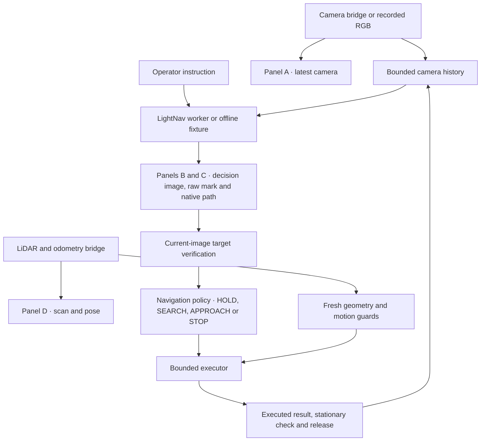

# From the website to a movement

The website starts in observation mode. Camera and LiDAR reception can proceed while the operator types. An instruction and a causal RGB history go to the model. Its answer is a target point or absence, ten local waypoints and a possible STOP. A supervisor decides what the evidence supports. An executor owns each dispatched movement.



The hardware diagram describes the supervised path. Observation mode ends at the proposal. The public five-move site substitutes the existing mock executor and sensor fixtures. Continuous mode runs its own expiring segments against a local kinematic proxy.

## From opening the website to physical movement

| What happens | Where to read it |
|---|---|
| Open the website | `app.main` starts a loopback session. Observe, five-move and continuous have separate entry functions. The server checks the host and per-session token. Switching mode closes existing sources, recorder and worker, then creates a new session and token on the same port. [Public launcher](../app.py) · [Mode transitions](../src/go2_perception/vln/web_modes.py) |
| Receive camera, LiDAR and pose while waiting | `open_sensors` builds a pair of read-only sources. The live camera child receives RTP/H.264. The live LiDAR child subscribes to the incremental cloud and odometry. Camera display and LiDAR recording have bounded queues. The executor separately obtains its own guard snapshots. [Sensor API](../sensors.py) · [Camera bridge](../scripts/go2_camera_bridge.py) · [LiDAR bridge](../scripts/go2_lidar_bridge.py) |
| Submit a target | `target_spec` preserves the original text and normalizes the requested object into “Go to the … and stop.” In a five-move episode `EpisodeUI.authorize` binds one area, budget, operator, clock epoch and target. A new decision needs a fresh image. [Target handling](../navigation.py) · [Episode UI](../src/go2_perception/vln/episode_app.py) |
| Get a raw prediction | For a real LightNav job the measured intrinsics rectify the fisheye image. The bounded episode retains the first two and latest six distinct causal frames on the 4 Hz grid. The observation-only worker uses its existing full-history policy. The isolated model process produces the point and the path in one request. The archived image in panel B may be older than panel A. [History selection](../src/go2_perception/vln/bounded_context.py) · [Native inference](../scripts/lightnav_worker.py) |
| Check which object was marked | `BoundProposalUI.proposal` verifies the model, frame hash, time, pose and coordinate convention. `ground` binds the current target point to an identified or rejected instance. The feature matcher checks reappearance of a named instance, with a region and image evidence. A new mark can require an operator decision. [Proposal binding](../src/go2_perception/vln/bound_proposal.py) · [Instance matching](../src/go2_perception/vln/episode_grounding.py) |
| Select a movement | `select_action` first checks grounding. An enrolled reference is localized independently of the native mark. Uncertain identity selects a bounded SEARCH for a fresh viewpoint. Five-move SEARCH checks new headings, remembers inspected views and stalls, and holds when neither turn has support. A current mark on the verified instance can permit APPROACH. Direction, distance or turn angle, clearance, inspected area, pose and remaining budget constrain the choice. Native STOP ends the model episode with arrival unverified. [Public decision policy](../navigation.py) |
| Execute and observe again | `EpisodeExecutor.dispatch` binds a selected primitive to a particular decision. In the separate hardware operator application, `HardwareMotion` uses the canonical controller's high-level route. It checks motion, braking, stillness and release. A new five-move decision follows settling and fresh observation. An executor result records what occurred. [Five-move executor](../src/go2_perception/vln/five_move.py) · [Independent motion owner](../src/go2_perception/vln/supervised_executor.py) |

### A real wrong-box example

In the November 19 closed box session, P002 put the raw point on an object in the hallway. The intended box was partly visible at the right edge. The operator rejected P002 and the executor dispatched nothing for it. On a new image, P003 still lacked supported box identity and selected a 0.30 m forward SEARCH step. The episode recorded two SEARCH dispatches, no supported approach, and a deadline. Neither their feedback distances nor the controller's stop report independently measure the physical distance traveled. The optional offline category comparison found a box at the right edge. Live instance verification uses the named reference. [Trace and prompt comparisons](TARGET_GROUNDING_REVIEW.md) · [Compare the same images before and after the change](OBJECT_GUIDED_NAVIGATION.md)

On this feature branch the closer box can also be matched using interior features from the bound 1280 × 720 rectified image. Even after successful recognition, a requested motion goes through clearance and area checks. The four historical forward SEARCH dispatches each become HOLD on the same recorded geometry. [Trial-by-trial evidence](NOV19_NAVIGATION_EVIDENCE.md)

## Choose inputs

Use the core interpreter in the development checkout. `app.py` pins local source before importing the shared environment's editable package. For older operator or developer scripts also set `PYTHONPATH`.

```bash
export GO2_WORKSPACE=/Users/yushan/Robotics/Go2
cd "$GO2_WORKSPACE/code/worktrees/codex-motion-diagnostics"
source "$GO2_WORKSPACE/envs/core/bin/activate"
export GO2_HARDWARE=0 GO2_SUPERVISED_LIVE=0
export PYTHONPATH="$PWD/src:$PWD/scripts:$PWD/hardware"
python app.py --source replay --episode tests/fixtures/vln/episode_v1/episode.json \
  --lidar-recording "$GO2_WORKSPACE/runs/five_move/trial-231Apz/session/lidar" \
  --min-free-disk-gb 10 --run-quota-gb 1 --port 0
```

`--lidar-recording DIR` accepts a legacy `go2-recording-v1` directory, a five-move trial, its session or its LiDAR directory. The command above pairs fixture RGB with actual recorded LiDAR for a reader demonstration. Each stream has its own clock. Use `app.py review --session DIR` for the original images and decisions from one closed trial. Without LiDAR, the geometry is unknown. `--model lightnav` selects the pinned worker in `envs/model` with local assets under `weights/lightnav`. Its input must meet the existing observation/calibration contract. `--source live` explicitly selects the read-only hardware reception children for observation. The public five-move mode always uses synthetic sources and its mock executor. The public continuous mode always uses the fixed chair fixture. Choosing a different target for real model inference belongs to observation or the authorized supervised application.

`Sensors.latest_frame()` returns an independent RGB array and metadata including frame ID, source/robot stamps where present, host receipt and available exposure estimate. `latest_cloud()` returns an independent XYZ array in metres with frame ID, scan stamp, midpoint, scan span, host monotonic receipt and robot epoch. Both return `None` before data arrives. `pose()` reports validity and a reason when unavailable. Check `status()` for host ages, source errors and drop counters. The LiDAR display downsamples the scan and can show odometry-compensated 0.5 s and 1.0 s windows. Camera optical coordinates and LiDAR/body coordinates remain separate. Full measured `T_base_camera` is unavailable.

## Change a setting

| Setting | Owner and consequence |
|---|---|
| Worker and model identity | `--model` and `--device` in [app.py](../app.py). [Pinned runtime configuration](../configs/pretrained_vln.yaml) and [native worker](../scripts/lightnav_worker.py) identify the checkpoint, preprocessing and decoder. Changing the model would require a new identity and compatibility review. |
| Requested description and instance evidence | [navigation.target_spec](../navigation.py) and [episode_grounding.ground](../src/go2_perception/vln/episode_grounding.py). Identification is tied to the specific image and full requested description. |
| Episode alignment and budget | `DEFAULT_ALIGNMENT_DEG` is 15 with the existing 3° hysteresis. The published supervised CLI accepts `--alignment-deg`, `--move-budget`, `--episode-seconds` and `--area-radius-m`. The executor separately enforces the supported ranges. [Policy defaults](../navigation.py) · [Supervised arguments](../src/go2_perception/vln/supervised_launch.py) |
| Speeds, stop lead and clearances | [motion_profile.py](../src/go2_perception/vln/motion_profile.py) and the hash-pinned [guard provider](../hardware/supervised_guards.py). The effective forward rate is 1.0 m/s and the turn rate is 2.0 rad/s on separate primitives. Revalidating measured limits belongs to the hardware owner. |
| Camera, LiDAR and odometry | [SensorSettings](../sensors.py) contains the named source and buffering defaults. [Measured camera intrinsics](../configs/go2_front_camera_calibration.yaml) and [sensor timing configuration](../configs/go2_vln_sensors.yaml) are separate from the executor's boot-specific guard evidence. |

## Test one component

Run these from the environment above. Each command below runs offline.

```bash
python -m pytest -q tests/test_application.py -k sensor
python -m pytest -q tests/test_five_move_navigation.py
python -m pytest -q tests/test_application.py -k website
python -m pytest -q tests/test_application.py -k matches_publication
python -m pytest -q tests/test_go2_replay.py tests/test_target_grounding_review.py
python -m pytest -q -rs
```

For the local real-image account, this generates a fresh private HTML/JSON report and validates source identity through operator review and executor dispatch.

```bash
python scripts/review_target_grounding.py \
  --session "$GO2_WORKSPACE/runs/five_move/trial-THKUcr/session" \
  --prediction T20261119-120816-01-3a48-P002
```

## Workspace and launch modes

`code/navigation` hosts this application on `hardware/readable-navigation-integration` and is also the checkout for supervised hardware sessions. `code/worktrees/codex-motion-diagnostics` is Codex's development worktree. `code/control` is the separate audited controller at `6d555d3`, with its single `data/outputs/go2_control/.command.lock`. The SDK checkout is `814556d`. `envs/core`, `envs/model` and `envs/hw` serve separate interpreters. Shared weights, input recordings, run logs and calibration evidence live outside the development checkout. `python app.py supervised --help` describes the separate five-move operator procedure. `--prepare-only` reads pinned local evidence and exits. `--live-exclusive` requires the existing process opt-in and a separate fresh browser episode authorization. The [five-move](FIVE_MOVE_NAVIGATION.md) and [one-action](SUPERVISED_NAVIGATION.md) operator procedures describe the separately authorized hardware applications. The [continuous guide](CONTINUOUS_NAVIGATION.md) records fixture and model timing limitations.

For historical phase commands use the pinned research tree listed in the [source inventory](CODE_INVENTORY.md). The [verification record](APPLICATION_REFACTOR.md) documents what was actually compared.
