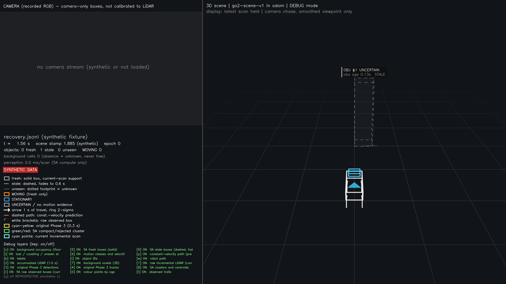

# Phase 5A.1 detection recovery experiments

This is an **offline development candidate**, not navigation-ready perception. The full
results are in [DETECTION_RECOVERY_RESULTS.md](DETECTION_RECOVERY_RESULTS.md), with counts,
event failures and candidate hashes in [DETECTION_RECOVERY_METRICS.json](DETECTION_RECOVERY_METRICS.json).
Only A1/A2/B/C were evaluated on real recordings. No held-out or live validation is claimed.

## Provenance and comparison design

Base: remote `phase5-fsd-visualization` at `89d901d`, verified by fetch before creating
`phase5-detection-recovery`. It includes Phase 5A `be4b9de`, the FSD viewer, Phase 3.8 diagnostics,
forecasting and hardware adapters. Those components and operational configs remain available.

Compared methods:

1. Original 0.3 s tracker at `ecfaae3`, cached comparison preserved from Phase 5A/5B.
2. Phase 5A's published 0.1 s profile at `be4b9de`, preserved aggregate metrics.
3. **Completed Phase 5A 0.3 s counterfactual**, unchanged perception algorithm with faster,
   semantically equivalent scalar validation. All 3,926 frames completed.
4. Recovery 0.1 s and 0.3 s, identical candidate except proposal horizon. Recent support stays
   0.2 s, body exclusion and motion settings are the same. Both process all 3,926 frames.

The final source/config hash manifest is included in the metrics as `freeze`. The last
behavioral correction invalidated motion evidence as well as history on ambiguous matching;
all final real results were rerun afterward. Earlier pilot outputs remain ignored and are
not reported as final. Candidate is frozen before any future H1–H3 held-out evaluation.
No claim of statistical generalization follows from development-set improvement.

## Freshness and metric definitions

**Current-direct coverage** requires a current sensor return supporting a compact proposal
plus at least three points in the previous 0.2 s. Motion regression requires at least three
current points. **Recent coverage** permits last direct support at age ≤0.2 s and reports
its real timestamp. Recent motion additionally requires valid timestamped motion evidence
within that horizon. **Availability** permits all emitted boxes up to the 0.6 s geometry TTL.
These are three different measurements; old geometry is never re-labelled fresh in output.
The evaluator makes a separate in-memory recent-evidence view, never serialized as a scene.

The original tracker considers accumulated-window updates observed, whereas Phase 5A/current
recovery use genuinely current support. Original coverage is retained for reference, but
its freshness standard is less strict; a zero-return message cannot truthfully become a
new direct measurement merely to match the original number. Phase 5A has no timestamped
recent motion extension, so its recent-evidence view does not invent carried MOVING labels.

Matching uses the existing per-frame gated Hungarian evaluator: 0.5 m person point, 0.15 m
static region. IDs are ignored for geometry matching. Adding recent objects can change a
one-to-one assignment, so recent recall need not monotonically increase. Conditional jitter,
velocity error and false MOVING must be read alongside all-truth moving recall and coverage.
Motion delay is from annotation label onset, not independently measured physical motion.
Null delay means failure to activate in the event; left-censored events must be excluded
from activation-delay summaries, never converted to zero.

Real annotations are LiDAR-derived, Claude-reviewed and not human-verified. A1/A2/B/C are
private development data, with limited object annotation; unannotated clutter cannot be
scored as verified false-positive objects. Duplicate counts are competing estimates in a
truth gate, not confirmed extra people. ID-change reliability is based on geometric matches,
not verified semantic identity. Raw recordings and scene outputs are not committed.

## Profile first, then optimize

Original unoptimized 0.3 s replay of Test B: after 50 warm-up frames, cProfile measured the
next 150 frames. Total profiled time 14.84 s; reported pipeline compute mean 55.01 ms,
p95 87.94 ms; process peak RSS approximately 229 MiB. The suspected `stable_mask` used only
0.117 s over 236 calls. The reported 9–18 s/frame slowdown was **not reproduced** on this
host/load. It cannot honestly be attributed to that function from this evidence.

Scene validation cost about 5.41 s under cProfile, including 227,358 `np.isclose` calls
across validation. The equivalent scalar tolerance `abs(a-b) <= 1e-8 + 1e-5*abs(b)` removes
per-cell NumPy dispatch overhead; finite JSON checking remains. Ground fitting, clustering,
background update and JSON work remain significant. No runtime annotation input is used.

A synthetic microbenchmark (6,000 query points, 30 repeats) compared map masks; a sorted
structured-array vectorization was slower (4.94 ms median versus reference 2.99 ms) and was
rejected. The retained implementation quantizes in NumPy and tests native integer tuples
against prequalified keys. The final timings are in the aggregate JSON. The 1,500-cell
validator microbenchmark measured approximately 11.79→1.21 ms before the final rerun;
these microbenchmarks are not end-to-end robot speedups. Mask identity and scalar tolerance
boundaries have automated regressions.

Real scripts record per-frame compute (before final validation/serialization), wall time
(input load + process + JSON write), observation ages and process high-water RSS. On macOS,
`ru_maxrss` is bytes; the generated report converts it to MiB. RSS includes imports, not just
point buffers. Runs use `OPENBLAS_NUM_THREADS=1 OMP_NUM_THREADS=1` on a shared development
host; occasional test/evaluation work and OS scheduling affect timings. These are measured
offline costs, not controlled real-time or end-to-end live latency claims.

## Synthetic evaluation and compatibility

Ten deterministic cases: original six (alternating partial samples, rotation, translation,
start moving, near furniture, sparse occlusion), plus missing-sector returns, stop/restart,
two people crossing and a person near a wall. Original cases retain seed 17 and 90 frames;
new cases use seed 101 and 120 frames at 0.065 s. Truth enters evaluation only. Each case
runs Phase 5A and recovery at both 0.1/0.3 s.

The new fixture `tests/fixtures/scene/recovery.jsonl` is a 12-frame excerpt of the synthetic
missing-sector case. Processing time is set to zero for deterministic bytes. It deliberately
alternates current support and recent-but-not-current support. Validate both the original
schema and optional companion schema; the existing viewer parses/renders it without changes.
The original `renderer.jsonl` fixture and v1 schema are unchanged.

## Reproduction

For a new worktree (Python 3.12, existing pinned dependencies):

```bash
uv venv --python 3.12 .venv
uv pip install --python .venv/bin/python -e '.[test,forecasting]'
export PYTHONPATH=src
.venv/bin/python -m pytest -q
```

Actual execution reused pinned site-packages read-only via an isolated Python 3.12.11
runtime because the older temporary base had expired. This is not a fresh clean-install
verification. Dependencies match Phase 5A/5B; no new runtime package was added. An initial
suite invocation failed only because a viewer subprocess test explicitly searches for
`.venv/bin/python`; creating the local environment fixed that environment issue.

Full real runs (use fresh output directories):

```bash
export PYTHONPATH=src OPENBLAS_NUM_THREADS=1 OMP_NUM_THREADS=1
D=/Users/yushan/Desktop/Go2_Navigation/data
for r in test_a1 test_a2 test_b test_c; do
  .venv/bin/python scripts/run_detection_recovery.py --baseline --window 0.3 --input "$D/recordings/$r" --output "data/outputs/recovery/baseline03/$r"
  .venv/bin/python scripts/run_detection_recovery.py --window 0.1 --input "$D/recordings/$r" --output "data/outputs/recovery/release01/$r"
  .venv/bin/python scripts/run_detection_recovery.py --window 0.3 --input "$D/recordings/$r" --output "data/outputs/recovery/release03/$r"
done
for variant in baseline03 release01 release03; do
  .venv/bin/python scripts/evaluate_detection_recovery.py --scenes "data/outputs/recovery/$variant" --annotations "$D/annotations" --output "data/outputs/recovery/${variant}_metrics.json"
done
.venv/bin/python scripts/benchmark_detection_recovery.py --output data/outputs/recovery/synthetic
.venv/bin/python scripts/read_scene.py tests/fixtures/scene/recovery.jsonl
.venv/bin/python scripts/fsd_viewer.py --scene tests/fixtures/scene/recovery.jsonl --mode debug --still 1.56 --output /tmp/recovery_fixture.png
```

To reproduce the committed fixture, pass `--fixture /tmp/recovery.jsonl` to the synthetic
benchmark with a new output directory, then compare with the committed file. Do not overwrite
fixtures silently. `report_detection_recovery.py` regenerates tables/aggregate JSON from the
completed run JSON plus freeze and microbenchmark manifests (included in the published
aggregate). Private data is necessary to rerun real experiments; synthetic tests/viewer
fixture require no robot or private recording.

The Phase 5B Debug tap instruments the original StableScene and remains unchanged; it is
not a recovery tap. View recovery JSONL directly in Clean mode or use the documented standalone
fixture Debug view. Do not attach an old 5A tap to recovery output and imply intermediates match.

## Synthetic findings and remaining regressions

- Missing-sector fixture: current coverage stays exactly 1/3, as only every third message
  sees the object. Recovery 0.3 s current MOVING recall is 0.30; bounded recent MOVING recall
  is 0.90. This is **not** 90% fresh observation. It demonstrates useful recent evidence
  while retaining truthful direct-observation semantics.
- Near-wall: Phase 5A moving recall is 0; recovery 0.3 s is 0.908, with 0.715 s activation.
- Stop/restart: recall improves 0.798→0.820 versus Phase 5A 0.1 s, but stationary-period
  false MOVING worsens **0.129→0.290**. The longer direct history delays stopping. This is
  a material failure, not a successful stop detector.
- Crossing: coverage 0.946→0.929 and current moving recall 0.721→0.713 versus Phase 5A 0.1 s.
  Conservative ambiguity resets reduce unsupported continuity but do not solve merged people.
- Near-furniture: recovery 0.3 s coverage is 0.689, moving recall 0.178 and static false
  MOVING 0.089, versus 0.711/0.189/0 for Phase 5A 0.1 s. It remains a failed separation case.
- Simple stationary sampling/rotation/translation regressions produce no MOVING labels in
  the automated checks. That does not establish stationary reliability in mixed geometry.

No threshold was selected using held-out data. The 0.3 s recovery profile is an opt-in
candidate for further validation, not an across-the-board winner. A next motion iteration
should explicitly measure stopping delay and reject mixed-object motion before any deployment.

## Automated and viewer verification

Full repository suite: **376 passed, 1 hardware skipped in 31.24 s**. Twenty-three new tests
cover exact optimized-mask behavior, validator tolerance boundaries, self-filter transforms,
nearby points, sampling gaps, real current-point support, start/stop/restart, ambiguous and
brief-gap associations, person-to-low-box protection, old/new schema compatibility, current
viewer parsing, missing poses/clock resets and stationary geometry under ego motion.

Scoped Ruff 0.11.2 passes. Repository-wide Ruff still reports the same **33 inherited
findings in four unchanged hardware diagnostic scripts**. No lint errors are hidden by
changing global excludes. Commands:

```bash
uvx --from ruff==0.11.2 ruff check .
uvx --from ruff==0.11.2 ruff check src/go2_perception/scene/*recovery*.py src/go2_perception/scene/coverage.py src/go2_perception/scene/fast_background.py src/go2_perception/scene/serialization.py scripts/*detection_recovery.py tests/test_detection_recovery.py
```

The existing viewer rendered the synthetic recovery fixture successfully; output was visually
inspected. It shows the recently observed object as stale/UNCERTAIN when no new return exists,
as required for backward compatibility. No private imagery is published.



## Final real results and decision

At the candidate's 0.3 s horizon, A2 pedestrian current coverage improves from Phase 5A
0.455 to **0.596** and current MOVING recall from 0.121 to **0.417**. B improves 0.499→**0.553**
and 0.058→**0.267**. Recent ≤0.2 s pedestrian coverage is 0.976/0.959 and recent motion recall
0.679/0.479 (A2/B); those are explicitly **not fresh observations**.

Most coverage recovery comes from the longer proposal window: unchanged 5A at 0.3 s already
achieves A2/B coverage 0.578/0.550 and moving recall 0.324/0.212. Additional recovery changes
are a smaller increment, not the entire improvement. The 0.1 s recovery variant does not
recover B motion reliably (recall 0.037). Original tracker coverage/recall remain higher
under its accumulated-window freshness definition.

Static annotated box false MOVING remains zero in all four candidate recordings. Stationary
person false MOVING rises from Phase 5A zero to **0.147 A2 / 0.047 B**; recent-evidence rates
are 0.154/0.052. Static box jitter is 0.116/0.093/0.076/0.078 m (A1/A2/B/C), worse than the
short-window 5A result despite better coverage. Current motion activation median is 0.292 s
A2 (10/18 non-left-censored events activated) and 0.325 s B (8/14). Remaining events fail;
do not report the medians without these denominators.

All-box stale share rises to roughly **0.74–0.75**, partly because longer-window proposals
produce more objects without current support. The matched-person recent-coverage result
must not hide this global staleness. Geometry-matched moving ID changes still occur (A2=6,
B=14); MOVING is present at the first subsequent observation in 0 and 2 cases respectively.
History retention is therefore not a solved identity/motion continuity problem.

Candidate mean compute is 28.9–30.9 ms; p95 30.8–38.1 ms. Mean per-frame wall time including
load/validation/JSON write is 39.6–42.3 ms; p95 46.4–62.5 ms. Cold first-frame maxima are about
0.81–0.86 s. Peak process RSS is 226–233 MiB. These are offline shared-host measurements.

**Self-return finding:** the conservative inner-body mask excludes **zero real points** in
all four recordings. It does not fix the recurring near-footprint floor artifact. In the
first 100 scans, a wider diagnostic XY footprint (±0.4 m, ±0.22 m, evaluation only) contains
about 11,400–11,600 returns at minimum XY radius about 0.32 m and median body z about −0.42 m,
outside the small inner-body mask. These can be floor/near-field returns rather than verified
robot material. Broadly cropping them would remove unverified nearby external geometry.
Hardware/body-height and ground-model verification are needed; no successful real self-return
removal is claimed. The configurable filter and synthetic pose/boundary tests are delivered.

The candidate is frozen for Claude's held-out evaluation, **not promoted**. Next priorities
are stopping/release behavior, mixed-object segmentation, measurement-backed self filtering
and visibility modeling. No robot autonomy is enabled.

To repeat the original profiling experiment and microbenchmarks:

```bash
PYTHONPATH=src .venv/bin/python scripts/profile_detection_recovery.py --recording /Users/yushan/Desktop/Go2_Navigation/data/recordings/test_b --output data/outputs/recovery_profile_repeat
```

The replay manifest records a final validation-only overflow guard added after real replays:
finite extreme timestamps whose subtraction overflows are rejected, as in the original
NumPy validator. Geometry/motion/config hashes are unchanged; both replayed and final file
hashes are retained. Real TTL-bounded ages are unaffected. The full tests were rerun.
