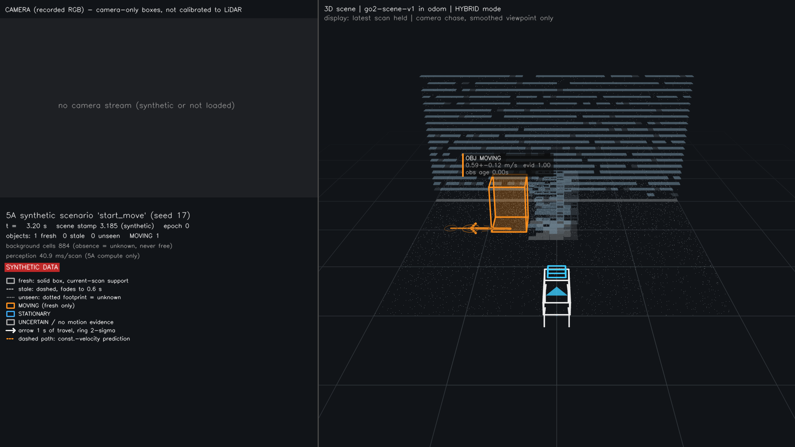

# FSD-style scene viewer (Phase 5B) — 2026-11-11

Branch `phase5-fsd-visualization`, started from Codex's Phase 5A commit
`be4b9deb3d3f0f8fc7e111c45464a1922db761ef` (`phase5-stable-lidar-perception`). Phase 5A sits directly on
`phase3-visual-groundtruth` (`9068088`), so the Phase 3.8 RGB + BEV diagnostic videos, the annotation
editor and the 5A scene pipeline all keep working. No operational default changed. No robot control.

The viewer consumes **go2-scene-v1** only ([contract](SCENE_REPRESENTATION_INTERFACE.md)). It shows what
the perception actually claims, including when that is stale, uncertain or missing. Accuracy beats a
smooth picture: nothing is extrapolated into a box, and stale boxes are never drawn as fresh.



## Framework choice

Evaluated on this Mac (macOS ARM64, Python 3.12.11):

| Option | Result |
|---|---|
| Open3D 0.19 `OffscreenRenderer` | **Fails**: `EGL Headless is not supported on this platform`. Video export would need a visible window plus screen grabs. Labels, dashed lines and translucency are awkward in the legacy visualizer. |
| rerun 0.42 | Good interactive viewer, but there is no headless frame/MP4 export (only `.rrd` recordings and a GUI). Adds a new dependency. |
| **NumPy + OpenCV software renderer (chosen)** | Pinhole projection, near-plane clipping, painter's order, ROI alpha blending. Already pinned dependencies, headless, deterministic, unit-testable. One code path drives both the interactive window (`cv2.imshow`) and MP4/PNG export. |

Cost: no GPU lighting or depth buffer. Measured 1920×1080 render rate (single process, no other load):
about 17 fps in Clean mode and 10 fps in Debug mode (real time is 15.4 fps). Under heavy parallel load
it drops (see [PHASE5_REAL_VALIDATION](PHASE5_REAL_VALIDATION.md#runtime)).

## Code layout (renderer separate from perception)

| Module | Role | Imports perception? |
|---|---|---|
| `viewer/scene.py` | Parse and validate v1 rows; reject NaN, missing fields (named), non-rigid poses, stale boxes with an observed box, object claims without a pose, any free-space policy other than `unobserved_is_unknown`; ignore unknown fields | no |
| `viewer/state.py` | Causal display state (fresh / stale / unseen), trails, epoch resets, `CausalPlayer` (no future frames), pose interpolation | no |
| `viewer/camera.py` | Pinhole camera; smoothed chase camera (viewpoint only) | no |
| `viewer/render.py` | All drawing | no |
| `viewer/layers.py` | Layer toggles and the Clean / Hybrid / Debug presets | no |
| `viewer/session.py` | Split view (RGB left, 3D right) and multi-panel comparisons | no |
| `viewer/sources.py` | Read the Debug tap, the Phase 3 caches and RGB; time alignment | no |
| `viewer/planning.py` | Planner-readiness queries (occupied or unknown, never free) | no |
| `viewer/privacy.py` | Refuse private outputs at paths Git would track | no |
| `diagnostics/scene_tap.py` | Instrumented replay of the **unchanged** `StableScene` (wraps its helpers to record intermediates) | yes, evaluation side |
| `diagnostics/attribution.py` | Failure attribution categories | no |

Scripts: `fsd_viewer.py` (viewer and export), `phase5b_scene_tap.py`, `phase5b_diagnose_walking.py`,
`phase5b_compare.py`, `phase5b_render_reels.py`, `phase5b_synthetic_demo.py`.

## Frames and transforms

- Scene points, cells and boxes are drawn exactly as received in `odom`.
- `T_odom_base` is used in one place, `render.draw_robot`, to place the Go2 proxy. A test renders the
  same scene with two different robot poses and gets identical scene pixels.
- Phase 3 detection boxes are stored in `base_link_level` with their planar pose. Their corners are
  transformed once, in `sources.Phase3.boxes`.
- The floor is drawn at robot z − 0.32 m (5A `sensor_height_m`). This is display only.
- When `epoch` changes, all renderer memory is cleared (trails, unseen footprints, robot path, camera).
- A null pose hides the robot, shows **NO POSE**, and is never replaced by identity.

## Visual language

| State | Drawing | Rule |
|---|---|---|
| Fresh | Solid box with translucent faces | `status=observed_filtered` with an `observed_box` (current-scan support) |
| Raw observed box | White corner brackets (Debug) | The current scan's directly supported box, distinct from the filtered box |
| Stale | Dashed edges, fading with observation age | Drawn up to `--stale-max-s` (default 0.6 s, equal to 5A's TTL); never longer than the producer emits it |
| Unseen | Dotted floor footprint labelled `unseen X s / unknown - not free` | Renderer-held for `--ghost-hold-s` (default 1.0 s) after the producer drops an object; never an object claim |
| MOVING | Orange | Only on fresh boxes with `motion_state=MOVING` |
| STATIONARY | Blue | Fresh only |
| UNCERTAIN, stale or unseen | Gray | Stale objects are always gray, even if a producer says otherwise |
| Velocity | Arrow on the floor showing 1 s of travel, a 2σ ring at the tip, and ±2σ heading spread lines | Not drawn while 5A reports its identity-covariance prior; the label then says `v n/a (prior)` |
| Constant-velocity path | Dashed line with 1σ·t rings (default 1.5 s) | Fresh MOVING objects with measured velocity only; labelled a prediction |
| Background occupancy | Floor tiles, brighter for evidence ≥ 0.5 | No tile means unknown, never free |
| Labels | `OBJ [#id] STATE`, `speed ±2σ m/s  evid score`, `obs age` | `OBJ` because 5A has no semantic class. `evid` is 5A's evidence/recency score, **not** a calibrated confidence. Labels are culled by priority (fresh MOVING first, then nearest within 5 m) and by overlap; geometry is never culled. |

## Modes and layers

`m` cycles the mode in the interactive viewer; `--mode` sets it for export; `--layer +name / -name`
overrides a single layer.

- **Clean** (default): occupancy footprint, fresh/stale boxes, unseen footprints, motion, CV path,
  labels, robot path. No raw points.
- **Hybrid**: Clean plus the 1.0 s accumulated cloud and 3D background voxels.
- **Debug**: every layer, each labelled with its key:

| Key | Layer | Key | Layer |
|---|---|---|---|
| 1 | raw incremental LiDAR (current scan) | 2 | accumulated LiDAR (1.0 s) |
| 3 | original Phase 3 detections | 4 | original Phase 3 tracks (filled = observed, `pred`/`pred LOST` = coasting) |
| 5 | 5A fresh boxes | 6 | 5A stale boxes |
| 7 | background voxels | 8 | 5A clusters (green compact, red rejected with reason) and centroids |
| 9 | motion classes and velocities | 0 | colour points by age |
| l | lost / coasting / unseen states | r | 5A raw observed boxes |
| o | occupancy footprint | p | CV path |
| b | labels | i | object IDs |
| w | robot path | t | observed trails |
| g | RETROSPECTIVE annotation | | |

The retrospective annotation layer is part of no preset. It must be enabled explicitly
(`--retrospective-gt` or `g`), and a magenta banner marks it as evaluation-only data.

## Timing, causality and smoothing

- `CausalPlayer` displays the latest frame with `timestamp <= clock`. Tests assert that no future frame
  is ever shown.
- Optional `--interpolate`: the whole display is delayed by `--interpolation-delay-s` (default 70 ms,
  about one scan). The robot pose is interpolated (translation lerp, rotation slerp) between two
  **already received**, same-epoch validated poses. Otherwise it is held. Objects are never
  interpolated; they come from the latest frame at or before the delayed clock. The HUD states the delay.
- The camera smoothing (exponential, τ = 0.6 s) advances only on scene frames, so a rendered image
  does not depend on how often it is drawn (seek and replay consistency is tested). It moves the
  viewpoint only, never geometry.
- The frame rate is configurable (`--fps`). Between scans the last scan is held.

## Split view

The left column shows the recorded RGB frame with the existing YOLO boxes (labelled camera-only, not
calibrated to LiDAR), the camera−LiDAR offset from host receipt (approximate), status, warnings and
the legend. The right side shows the 3D scene. No LiDAR ID is ever drawn on the camera image: there is
no verified calibration. The Phase 3.8 RGB + BEV diagnostic videos and `render_tracking_video.py` are
unchanged.

## Commands

Environment for a new checkout or worktree:

```bash
uv venv --python 3.12 .venv
uv pip install --python .venv/bin/python -e '.[test,forecasting]'
export PYTHONPATH=src
```

Synthetic (no private data):

```bash
.venv/bin/python scripts/fsd_viewer.py --scene tests/fixtures/scene/renderer.jsonl                      # interactive window
.venv/bin/python scripts/fsd_viewer.py --scene tests/fixtures/scene/renderer.jsonl --mode debug --still 1.0 --output /tmp/fx.png
.venv/bin/python scripts/phase5b_synthetic_demo.py --output data/outputs/phase5b_synthetic --screenshots docs/media/fsd
```

Real recordings (private; run from this worktree, data in the main checkout):

```bash
D=/Users/yushan/Desktop/Go2_Navigation/data
O=$D/outputs/phase5b
# 1. Instrumented 5A replay (scene.jsonl identical to run_stable_scene.py + Debug sidecar)
for r in test_a1 test_a2 test_b test_c; do
  .venv/bin/python scripts/phase5b_scene_tap.py --input $D/recordings/$r --output $O/tap/$r
done
# 2. Interactive viewer
.venv/bin/python scripts/fsd_viewer.py --recording test_b --data $D --mode debug
# 3. Clean scene videos
for r in test_a1 test_a2 test_b test_c; do
  .venv/bin/python scripts/fsd_viewer.py --recording $r --data $D --mode clean --output $O/videos/${r}_clean.mp4
done
# 4. Diagnosis, comparison, reels
.venv/bin/python scripts/phase5b_diagnose_walking.py --recording test_b --data $D --output $O/diagnosis/test_b.json
.venv/bin/python scripts/phase5b_compare.py --data $D --variant 5A=$O/tap --output $O/comparison_5A.json
.venv/bin/python scripts/phase5b_render_reels.py --data $D --out $O/videos layers compare static montage highlights
```

Interactive keys: `space` pause; `a`/`d` step one scan; `A`/`D` step 2 s; `m` cycle mode; `c` cycle the
camera (chase / fixed heading / static); `[` `]` orbit; `-` `=` zoom; `f` quarter speed; layer keys as
in the table above; `q` quit. During development the window was not opened on the user's screen; every
image was produced through the same `Session.render` used by export.

All real-data outputs are written to git-ignored `data/outputs/` (checked by `viewer/privacy.py`). The
viewer refuses to write recording imagery anywhere Git would track.

## Tests

`tests/test_fsd_viewer.py`, 43 tests, synthetic only. They cover:

- schema parsing and named missing fields;
- JSON Schema agreement;
- NaN, pose, stale-box and free-space rejection;
- unknown-field tolerance;
- transforms (pose independence, Phase 3 corners transformed once, projection and clipping);
- camera smoothing;
- causal playback and interpolation across epochs;
- RGB alignment;
- stale fade and expiry, unseen footprints, epoch reset, out-of-order rejection;
- motion colours, the prior-velocity rule, arrow direction;
- mode presets and layer toggles, pixel effects of layers;
- full synthetic session rendering, deterministic and seek-consistent replay;
- H.264 export decoded back with ffprobe and OpenCV;
- privacy paths and CLI refusal;
- planner queries never returning free;
- attribution stage logic.

## Limitations

- Software rendering: no GPU depth buffer. Thin occluded edges can show through faces; boxes are drawn
  far to near.
- Labels use 5A's `object_id`, a per-run continuity handle. It is not a pedestrian identity, and 5A
  emits `track_id=null`.
- The camera panel is time-aligned by host receipt only (p95 offset about 34 ms); exposure latency is
  unmeasured.
- The floor height is a display assumption (robot z − 0.32 m); slopes and stairs are not handled.
- Debug sources need the tap sidecar (about 225–340 MB per recording, compressed). Clean mode needs only
  `scene.jsonl`.
