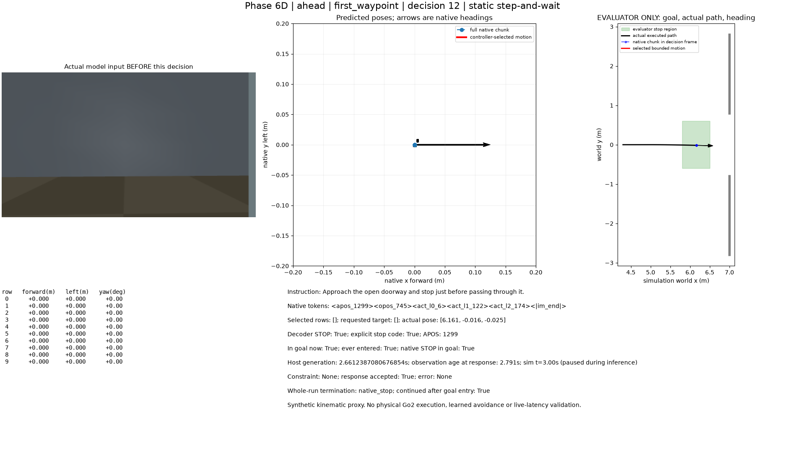
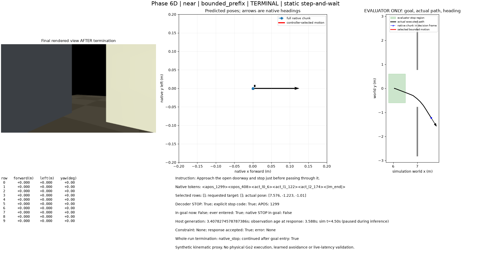
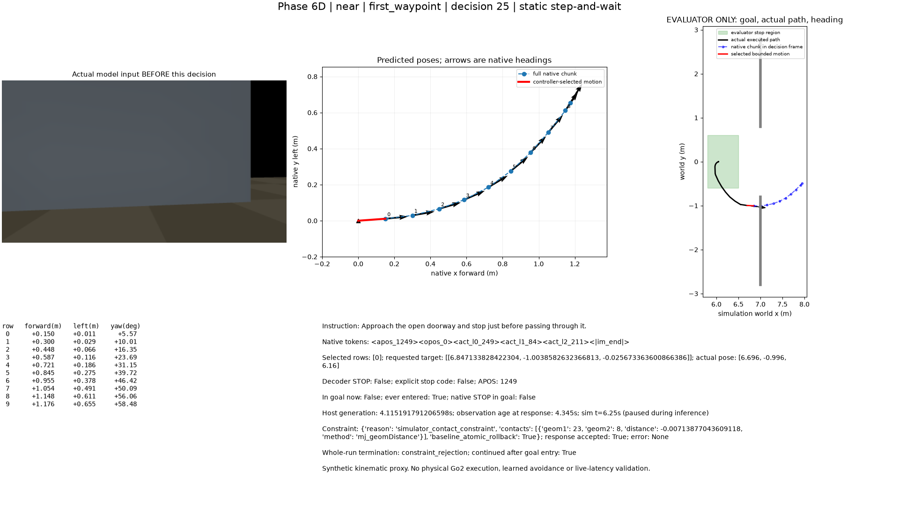

# Phase 6D waypoint execution and visible-goal navigation

Date: 2026-11-15. Branch `phase6-waypoint-validation`; isolated worktree
`/Users/yushan/Desktop/Go2_Navigation/data/outputs/phase6d-worktree`, based exactly on
Phase 6C publication `45154f6b9f05227de74254cb4562d7e0ad07b7dd`. No main merge or
operational-default change. See [contract audit](WAYPOINT_EXECUTION_AUDIT.md).

## Fixed model, runtime and preservation

LightOriginsHQ/LightNav-0 checkpoint/processor/RVQ
`826dc5fbfa37afa8293d2e336d329b6ffc0bfb64`, official code
`3015508b70fb6e30bbd66701e94c9b916dcb8df8`. Existing MPS BF16/SDPA runtime, no
quantization, same-BF16 CPU pooling fallback patch
`bec34b7d855f33ac94ec212a61ca507d2d677d82441add0cd1b2dfe7088e554c` unchanged.
No new weights, installations, real-robot client, network motion transport or training.

Actual Mac: Apple M3 Pro 18-core GPU, macOS 26.6.2 arm64, 36 GiB unified RAM.
Preflight available RAM 15,329,476,608 bytes, free disk 22,953,807,872 bytes.
Python 3.11.13 / Torch 2.10.0 / Transformers 5.8.0 / NumPy 2.4.6 / MuJoCo 3.3.7.
MPS available outside the sandbox. No NVIDIA driver/toolkit, CUDA runtime null.
Existing isolated `phase6c/model-env` and `phase6c/core-env` reused unchanged.
The new worktree's ignored `.venv` symlink targets the latter; no sensor/calibration
environment changes. Windows inventory remains independent and unexecuted here.

Artifact root (local, ignored):
`/Users/yushan/Desktop/Go2_Navigation/data/outputs/phase6d/waypoint_validation/`.
The four Claude packages (434 files) and saved SmolVLM baseline (293 files) match
the strict Phase 6C final inventory. A separate 273-file snapshot protects the old
failed simulation, its full-chunk review, and Claude's new review files. Source
files and old results are read in place, not rebuilt, relabeled or overwritten.

## Pre-model evidence

- Native units/frame/STOP audit: no decoder or coordinate defect established.
  Original first-waypoint baseline retained. One added `bounded_prefix` policy
  follows fixed-frame poses under explicit speed/rate limits; no evaluator goal
  appears in its inputs. It is a holonomic camera proxy, not upstream unicycle MPC.
- Ten model-free numeric cases and four camera previews saved under
  `controller_diagnostics_v1/`; video under `controller_diagnostics_v1_review/`.
  The deliberate wall intrusion is rejected after 0.29 s at the last safe pose.
  Known-path doorway approach reaches the centre in 2.3125 s, then holds to 3 s.
  Endpoint/cross-track errors are numerical roundoff. Geometry-assisted paths are
  controller diagnostics, never model-generated navigation.
- Actual colored-landmark rendering verifies camera axes, image orientation and
  proxy following. Source and native processed previews are pixel-identical.
  Pinhole simulated inputs never pass through measured Go2 fisheye rectification.
- Claude's review, commit `4a168e165e8eee58b7fcd4fc5a192e9791d3c278`, finds the
  original doorway recognizable. Keep the same scene/camera; new close-up views
  remain a limitation, not a human-certified stopping observation. Review report:
  [PHASE6D_BEHAVIOR_REVIEW](https://github.com/binbin-ovo/Go2_Navigation/blob/4a168e165e8eee58b7fcd4fc5a192e9791d3c278/docs/PHASE6D_BEHAVIOR_REVIEW.md).
- Saved repetition audit: eight distinct pixel tensors at old steps 1–8, despite
  byte-identical outputs. HF does not use the episode ViT cache. No stale-image
  cause established; model interpretation/repeated action selection remain open.

## Declared diagnostic suite (before model results)

Four starts × two policies = **eight conditions**, one run each, no outcome-based
extensions or retries. This is development diagnostics, not broad generalization.
Instruction, identical for all: **“Approach the open doorway and stop just before
passing through it.”** It is changed once from the old right-turn prompt before
the new suite. Old scores and failed rollout remain historical evidence.

| Case | Initial world pose [x m, y m, yaw rad] | Purpose |
|---|---|---|
| ahead | [4.3, 0, 0] | visible doorway ahead |
| left | [4.3, 0, -0.4363323129985824] | same doorway initially left |
| right | [4.3, 0, +0.4363323129985824] | same doorway initially right |
| near | [6.05, 0, 0] | already in the evaluator stop region |

Scene: unchanged `configs/simulation_vln_room.xml`, SHA256
`a3b752beaf74151ffb1489dd425c69aa66cda43fbdc375b7a9eae2e765c666e2`.
Camera: 448×256, fovy 60 degrees, height 0.65 m, body x offset 0.16 m, forward
along body +x. Goal rectangle x=[5.8,6.5], y=[-0.6,0.6], no orientation requirement;
centre [6.15,0]. Only evaluator/constraint code receives geometry.

Policies: unchanged first waypoint, at most 0.25 m / 32 degrees over 0.25 s;
new ordered prefix at 0.8 m/s and 3 rad/s, <=0.01 s collision samples, same 0.25 s
replanning window. Native chunk and selected targets are retained separately from
actual safe motion. The prefix can interrupt at the last safe substep; baseline
atomic rejection/rollback remains its original behavior.

Uniform budget: **24 simulated seconds, 96 decisions, 900 host seconds** per
condition, including asset verification/model loading in the process-level limit.
Responses older than 120 host seconds are rejected before motion. The longest
known geometry route is 1.85 m with <=25-degree initial heading error: <=2.458 s
for a turn then approach at prefix limits (2.3125 s if concurrent). The uniform
24 s budget is >9× that geometric feasibility time; it cannot guarantee a learned
policy makes progress. No failed run will be selectively extended.

Static step-and-wait: capture, pause for inference, execute chosen motion, render
again. Actual simulated images at 4 Hz enter native SlowFast; reset only at episode
or clock-epoch boundaries. No previous proposals/executed actions, labels, pose,
target coordinates, shortest paths or evaluator completion are passed to LightNav.
Host latency and simulated time are separate. No dynamic obstacle or live-latency claim.

Success requires **accepted native action STOP inside the rectangle**. Goal entry
alone is separate. APOS completion and RVQ stop evidence are preserved separately.
Also report premature STOP, post-entry movement, and external budget/safety/error
termination. Goal entry never triggers an execution override. “Continued after
entry” includes any translation or rotation after the first in-region sample,
even motion still within the rectangle. Path error is adherence to the selected
native path, not goal correctness or dynamic tracking performance.

## Results: all eight conditions executed once

Execution implementation: `d1590eb0c63046b3899325b70d6908e88a59e453`, published before
results. Frozen declaration SHA256:
`0c26c9678692955de374a52d5e5f5c7c29bcc33a72778a3d7b97bd7f96f34f4e`.
**121 actual model calls, 121 valid native decodes, seven native STOPs, six STOPs
inside the goal.** No run reached its host, simulation or decision budget. No run
was extended, retried or selected away. All settings stayed frozen throughout.

| Start | Policy | Decisions | Sim time s | Path m | Initial / min / final goal-centre distance m | Native STOP | Outcome |
|---|---|---:|---:|---:|---|---|---|
| ahead | first waypoint | 13 | 3.00 | 1.861 | 1.850 / 0.016 / 0.019 | inside | criterion met |
| ahead | bounded prefix | 11 | 2.50 | 2.000 | 1.850 / 0.003 / 0.150 | inside | criterion met |
| left | first waypoint | 15 | 3.50 | 2.014 | 1.850 / 0.235 / 0.298 | inside | criterion met |
| left | bounded prefix | 11 | 2.50 | 1.916 | 1.850 / 0.057 / 0.087 | inside | criterion met |
| right | first waypoint | 15 | 3.50 | 2.023 | 1.850 / 0.265 / 0.329 | inside | criterion met |
| right | bounded prefix | 11 | 2.50 | 1.916 | 1.850 / 0.084 / 0.109 | inside | criterion met |
| near | first waypoint | 26 | 6.25 | 1.395 | 0.100 / 0.100 / 1.136 | none | external contact-constraint rejection |
| near | bounded prefix | 19 | 4.50 | 2.036 | 0.100 / 0.032 / 1.879 | outside, after exit | wrong-place native STOP |

The six approach cases enter the goal at 1.877–2.775 simulated seconds. The two
near cases **start inside it**; do not count those as successful approaches. All
eight move after first goal entry under the declared definition. None stops before
ever entering the region. One stops after leaving it. No evaluator goal-aware stop
override was used. All seven STOPs have explicit RVQ level-zero code 6 and APOS 1299;
the near-prefix result shows these tokens do not guarantee correct completion.

There is one rejected penetrating contact candidate, in near/first-waypoint; the
baseline rolls that whole action back. No accepted path has a penetrating contact.
This is a simulator constraint result, not learned collision avoidance. Maximum
adherence error over all runs: 2.23e-16 m XY and 1.06e-11 rad heading. Exact kinematic
tracking of a model path does not establish that the path is appropriate.

Both policies meet the criterion on three of four starts. Prefix uses fewer
decisions for approach, but rate limits and path consumption both differ; no
isolated controller superiority or generalization result is supported.

## Diagnosis and remaining uncertainty

**No execution-frame, axis, sign or RVQ-decoder defect established.** Numeric paths,
rendered axes and selected-versus-actual traces agree. First-waypoint execution can
reach and stop in these approach conditions, so the old failure is not evidence
that this adapter inherently cannot navigate the room. The extra policy does not
fix the already-near-goal failure.

The right-start initial PNG **and exact BF16 input pixel tensor** are byte-identical
to the old failure's first input (tensor SHA256
`12e77ac9952c9fb0be230a61a81cfedcbeb417d097f1af0bbcf671c8208d233d`). The old instruction
produced a roughly -90-degree chunk and OPOS 0; the new instruction produced a
roughly -30-degree chunk and OPOS 612. The checkpoint/runtime remain fixed. This
supports **instruction sensitivity** in the first prediction. It is not a controlled
full-rollout prompt ablation: the new streaming wrapper differs, and the routes
subsequently diverge. Given the same source images, native-buffer equivalence is
tested and HF bypasses the episode ViT cache. Saved old inputs were distinct during
the repeated-output segment; stale input/cache explanations are not supported by
that evidence. Why the model selects repeated semantic actions remains unresolved.

The near cases demonstrate unreliable completion from the initial close-up: one
never stops before a rejected motion; the other crosses through the doorway and
stops in the wrong place. The close-up has much of the doorway frame outside the
camera, and no preceding approach history. These factors are confounded with the
model's stopping behavior. Do not label either as an isolated stop-decoder defect,
or claim a visual-domain cause without further review. New-run human behavior
review is **pending**. Claude's earlier 16 answers are historical evidence, not
new annotations for these eight runs. The original failed rollout and pilot scores
remain unchanged, including the E4 prompt/reference mismatch.

## Evaluator correction, with original results retained

Post-run inspection found a **metric-labeling defect**, not an execution defect:
the initial scorer labeled every outside-goal STOP as “premature,” including a STOP
after leaving a previously entered goal. The corrected scorer separates
`native_stop_outside_goal`, `premature_native_stop` (before any entry), and
`native_stop_after_goal_exit`. A regression test covers entry, exit, then STOP.
Only the near-prefix premature flag changes true → false; its failure remains a
wrong-place STOP after exit. Three distance values differ by <3e-16 m because the
core rescorer uses NumPy 1.26 instead of the model worker's 2.4. No threshold,
success result, action, native output or trajectory changes.

Raw `suite_v1/aggregate.json`, per-run summaries and frozen declaration are untouched.
`suite_v1_rescored_v2.json` binds their hashes and records changed metrics. No model
was rerun for this correction. The frozen v1 implementation check correctly rejects
the later scorer source; repeat from the execution commit for the original scorer,
or freeze a fresh declaration for the corrected one. Controller/worker code did
not change after the model runs started.

## Latency, memory and actual-input audit

| Start / policy | Native generation mean / max s | Mean host image age s | Peak process RSS GiB | Sampled MPS driver max GiB |
|---|---:|---:|---:|---:|
| ahead / first | 1.752 / 2.661 | 1.847 | 10.922 | 10.339 |
| ahead / prefix | 1.667 / 2.328 | 1.750 | 10.994 | 9.212 |
| left / first | 1.883 / 2.896 | 1.984 | 10.995 | 10.551 |
| left / prefix | 1.752 / 2.480 | 1.846 | 10.994 | 9.212 |
| right / first | 2.038 / 3.073 | 2.141 | 10.995 | 10.550 |
| right / prefix | 1.780 / 2.399 | 1.873 | 10.995 | 9.212 |
| near / first | 2.733 / 4.406 | 2.893 | 10.994 | 10.864 |
| near / prefix | 2.154 / 3.408 | 2.273 | 10.995 | 10.778 |

Across 121 calls: native generation mean 2.073 s, median 1.951 s, range
0.971–4.406 s. Host observation age mean 2.186 s, range 1.002–4.665 s, includes
preparation/evidence work. Simulation is paused during all of this time.
The separately recorded worker-relative age at native output averages 2.123 s
(0.985–4.520 s); it excludes pre-worker camera serialization and is a lower bound
on complete capture-to-output age. Full capture-to-response age is its upper bound.
Exact full capture-to-native-output instants were not separately stored; do not
present the response measurement as that exact instant. All underlying timing
fields are retained in per-decision results.
Fresh model load 43.562–46.677 s per process, separate from observation age;
per-condition host process time 70.931–127.493 s, total 678.223 s. These are
diagnostic shared-workstation timings, including initial kernel warm-up, not a
controlled throughput benchmark. Some review rendering overlapped earlier runs.

Peak lifetime process RSS 11,805,474,816 bytes (10.995 GiB); sampled MPS driver max
11,665,195,008 bytes (10.864 GiB). Unified-memory measures overlap; do not add them.
Driver sampling is a lower bound on its true peak. This validates only this small
Mac combination, not Windows 8 GB feasibility or any Isaac installation.

Actual-input audit verifies all 121 jobs: only instruction/identities/causal images,
one new actual simulated observation per call, eight distinct epochs, exactly one
native reset per episode, current frame included in native sampling, and native
current-image PNG bytes matching their already-native-sized source. Every model
process reverified checkpoint/source assets. All 727 package/baseline files and
273 retained old-simulation/review files remain byte-identical after the suite.

## Visual evidence and artifacts

All eight videos are in `suite_v1_review_v2/<case>__<policy>/rollout.mp4` under the
artifact root above, indexed by `suite_v1_review_v2/index.json`. They are verified
1920×1080 H.264, 129 panels total (121 decisions plus eight terminal views). Every
declared run is included. Each panel shows actual RGB input, full chunk/heading
table, selected motion, actual path, evaluator goal, native STOP and termination.

Representative success: `suite_v1_review_v2/ahead__first_waypoint/rollout.mp4`.
Failures: `suite_v1_review_v2/near__first_waypoint/rollout.mp4` and
`suite_v1_review_v2/near__bounded_prefix/rollout.mp4`. Original failure remains in
`phase6c/sim_closed_loop_v1_review_full_chunks/rollout.mp4`. Earlier review versions
are retained; v2 changes plot margins/aspect only, not inference or metrics.

Only synthetic images and [aggregate metrics](assets/phase6d_results.json) are published:





## Verified automated tests

Final full suite: **591 passed, 9 skipped in 46.87 s**, including cached SmolVLM
inference and the evaluator-correction regression. Pre-model suite: 590 passed,
9 skipped in 30.67 s.
Core skips: physical Go2 disabled; two optional MuJoCo modules; six native-runtime
cases requiring the separate model environment. Optional environment: 18 cases
passed before a Transformers source-read stall interrupted the last pooling test;
that single same-dtype CPU/MPS check passed separately in 34.46 s. Thus all 19
optional cases executed successfully across those runs. The interrupted combined
run is not reported as a completed all-pass run. Logs/XML: `audit/`.

The first sandbox full-suite run had 587 passes, two failures, nine skips: existing
ffmpeg/ffprobe checks could not open OpenMP shared memory. After running outside
that restricted sandbox, with no test weakening or environment install, the full
suite passed; one new stale-response case was added before the final run.

## Reproduction

Use existing environments. Every artifact output directory/file must be new.

```bash
cd /Users/yushan/Desktop/Go2_Navigation/data/outputs/phase6d-worktree
P6C=/Users/yushan/Desktop/Go2_Navigation/data/outputs/phase6c
P6D=/Users/yushan/Desktop/Go2_Navigation/data/outputs/phase6d/waypoint_validation
PYTHONPATH=src MUJOCO_GL=cgl "$P6C/model-env/bin/python" scripts/diagnose_waypoint_execution.py \
  --assets "$P6C/lightnav" --output "$P6D/controller_diagnostics_repeat"
PYTHONPATH=src .venv/bin/python scripts/review_waypoint_validation.py \
  --diagnostics "$P6D/controller_diagnostics_repeat" --output "$P6D/controller_diagnostics_repeat_review"
PYTHONPATH=src GO2_HARDWARE=0 HF_HUB_OFFLINE=1 \
  SMOLVLM_MODEL_CACHE=/Users/yushan/Desktop/Go2_Navigation/data/outputs/phase6b/hf_cache \
  .venv/bin/python -m pytest -q -rs
PYTHONPATH=src MUJOCO_GL=cgl MUJOCO_RENDER_TEST=1 LIGHTNAV_ASSETS="$P6C/lightnav" \
  "$P6C/model-env/bin/python" -m pytest -q -rs tests/test_waypoint_native_integration.py \
  tests/test_waypoint_simulation.py tests/test_vln_simulation.py tests/test_lightnav_runtime_integration.py
```

The checked-in YAML is a draft template. The actual reviewed copy is
`$P6D/reviewed_suite_v1.yaml`. It binds the published report's
commit, SHA256, reviewed scene SHA256 and actual processor-preview manifest. Set
its `status` to `reviewed_ready` only after reading the evidence. Do not fabricate
review fields. `freeze` refuses the draft. It hashes implementation and scene;
subsequent changes are rejected rather than silently applied to a frozen experiment.

```bash
PYTHONPATH=src .venv/bin/python scripts/run_waypoint_suite.py freeze \
  --config "$P6D/reviewed_suite_v1.yaml" --output "$P6D/frozen_suite_repeat.json"
PYTHONPATH=src MUJOCO_GL=cgl HF_HUB_OFFLINE=1 \
  PYTORCH_MPS_HIGH_WATERMARK_RATIO=0.5 PYTORCH_MPS_LOW_WATERMARK_RATIO=0.45 \
  "$P6C/model-env/bin/python" -u scripts/run_waypoint_suite.py run \
  --declaration "$P6D/frozen_suite_repeat.json" --assets "$P6C/lightnav" --output "$P6D/suite_repeat"
PYTHONPATH=src .venv/bin/python scripts/review_waypoint_validation.py \
  --suite "$P6D/suite_repeat" --output "$P6D/suite_repeat_review"
PYTHONPATH=src .venv/bin/python scripts/summarize_waypoint_suite.py \
  --suite "$P6D/suite_repeat" --output "$P6D/suite_repeat_metrics.json"
```

The actual execution commands used `frozen_suite_v1.json` and `suite_v1` on commit
`d1590eb0c63046b3899325b70d6908e88a59e453`; they are preserved. Exact source replay
requires a separate checkout of that commit because the evaluator was subsequently
corrected. The repeat commands above bind the current corrected code to a fresh
declaration without changing conditions. Never overwrite or reuse the existing
artifact destinations. For **read-only reanalysis** of the completed suite:

```bash
PYTHONPATH=src .venv/bin/python scripts/summarize_waypoint_suite.py \
  --suite "$P6D/suite_v1" --output "$P6D/suite_v1_metrics_repeat.json"
PYTHONPATH=src .venv/bin/python scripts/audit_lightnav_repetition.py \
  --run "$P6C/sim_closed_loop_v1" --output "$P6D/audit/repetition_repeat.json"
PYTHONPATH=src .venv/bin/python scripts/audit_pretrained_inputs.py \
  --phase6b-root /Users/yushan/Desktop/Go2_Navigation/data/outputs/phase6b \
  --compare "$P6D/audit/inputs_before.json" --output "$P6D/audit/inputs_repeat.json"
```

Native data: `<suite>/<case>__<policy>/rollout/inference/NNN/`; all source images,
jobs, chunks and actual-path traces remain alongside. Each run has an isolated
process so a model stall cannot exceed its host budget or leak history to another
condition. The parent records every declared condition, including worker failures.
Raw frames are synthetic; private Go2 images/labels remain outside these new jobs.
