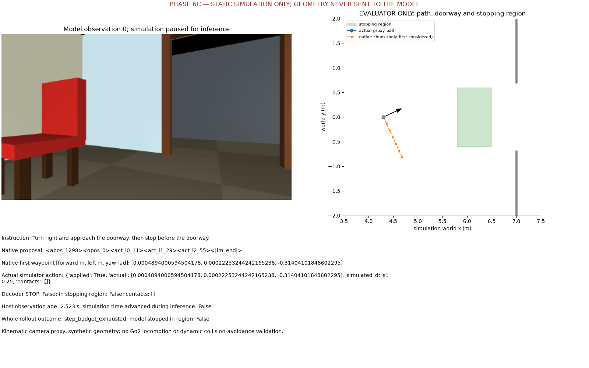
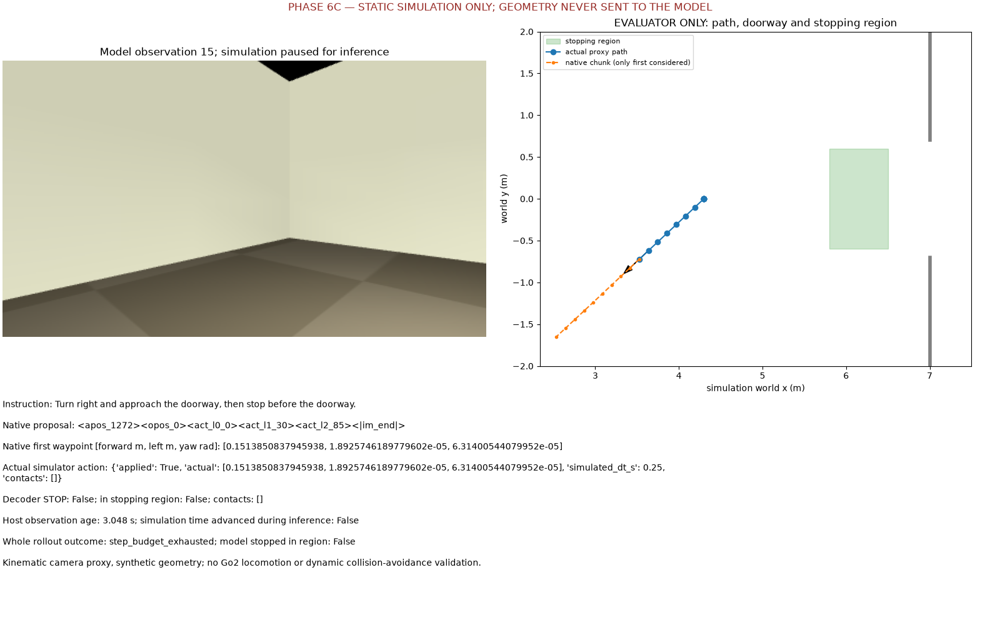

# Phase 6C: pretrained navigation experiments

Date: 2026-11-13. Branch `phase6-pretrained-vln`, based on verified Phase 6B
`7e2989ad54b9c484d75c029ff0141834880852b6`. No main merge, operational-default change,
robot connection, private upload or training. [Feasibility/model audit](PRETRAINED_VLN_FEASIBILITY.md)
and [Windows/simulator status](WINDOWS_SIMULATION_FEASIBILITY.md) explain the hardware gates.

## Runtime and isolation

Actual inference machine: Apple M3 Pro, macOS 26.6.2 arm64, 36 GiB unified memory.
Model: **LightOriginsHQ/LightNav-0**, checkpoint/processor/RVQ revision
`826dc5fbfa37afa8293d2e336d329b6ffc0bfb64`; official code
`3015508b70fb6e30bbd66701e94c9b916dcb8df8`. This is a navigation-trained checkpoint.
One checkpoint downloaded, full weight SHA256 verified; StreamVLN was audited only.

Separate Python 3.11.13 model environment: Torch 2.10.0, torchvision 0.25.0,
Transformers 5.8.0, NumPy 2.4.6, Pillow 13.0.0, safetensors 0.8.0. Exact environment:
`requirements-pretrained-vln-macos-tested.txt`. **MPS, BF16, official SDPA, no quantization,
no weight offloading**, greedy 64-token maximum, seed 0, four CPU threads. The only CPU
compute fallback is the native non-divisible adaptive-average-pooling operation.
The model uses `VLNQwen3VLProcessor`, its official normalization/template/SlowFast policy
and RVQ decoder. No upstream robot client was downloaded or invoked.

The core preparation/evaluation environment is a new Python 3.12.11 environment
constrained to Phase 6B versions (Torch 2.6.0, NumPy 1.26.4, OpenCV 4.11.0,
Transformers 4.51.3). Neither the existing Phase 6B environment nor Claude's calibration
environment was changed. `PYTHONPATH=src` selects this worktree explicitly.
This worktree's ignored `.venv` is a symlink to that **new** `core-env`, needed by
an existing viewer test that explicitly probes `.venv/bin/python` and replaces PATH.
Both environments pass `uv pip check` (88 core / 56 model packages).

Private artifact root throughout this report:
`/Users/yushan/Desktop/Go2_Navigation/data/outputs/phase6c/` (Git-ignored).

## Actual runs, including failures

1. **Unmodified official CLI, synthetic frames, CPU:** weights loaded, then an
   unconditional CUDA synchronization raised `AssertionError: Torch not compiled with
   CUDA enabled`. Whole command 60.36 s. This was not successful inference.
   Log: `audit/official_unmodified_smoke.log`.
2. **Portable device/timing fork, same official CLI, MPS:** successful synthetic
   inference, native output
   `<apos_1138><opos_611><act_l0_21><act_l1_143><act_l2_66><|im_end|>`, decoded by the
   official RVQ implementation. Native generation 7.0302 s; whole process 52.35 s;
   maximum RSS 11,733,073,920 bytes (10.927 GiB). No synthetic accuracy claim.
   Log: `audit/official_portable_mps_smoke.log`; inputs: `public_smoke_frames/`.
3. **Private preparation v1:** all 11 causal jobs prepared; worker failed before
   model loading because resolving a venv Python symlink selected its base interpreter.
   The parent now preserves the launcher path; regression test added. Run retained.
4. **Private v2:** five decisions decoded, then E2's longest history hit an MPS
   non-divisible adaptive-pooling limitation. The exact failure and successful prefix
   remain in `claude_pilot_v2/`; no scores are reported as a complete run from it.
5. **Private v3:** all **11/11** decisions generated valid three-level RVQ tokens and
   decoded ten native waypoints each. Same frozen preparation as v2, checkpoint,
   instructions, cutoffs and predeclared comparison mapping. Only runtime pooling
   portability was fixed. Final local fork is `lightnav/source-local-v2/`, patch
   SHA256 `bec34b7d855f33ac94ec212a61ca507d2d677d82441add0cd1b2dfe7088e554c`.
   Native CPU/MPS fallback embeddings, grids and deepstack outputs tested bit-identical.

Several local file readers intermittently stalled, sometimes returning `Operation
canceled` or a transient empty read; fresh reads succeeded. This was recorded as an
environmental access problem, not hidden with substituted data. V3 reused the exact
previously validated `claude_pilot_v2/jobs.json` and prepared images. Its declaration
records the source declaration hash, unchanged jobs hash, manifest hashes and new
worker code hashes. This did not rebuild or relabel Claude's packages.

Preservation check: all **434 package files** and **292/293 baseline files** match the
original preflight hashes. One baseline PNG's initial inventory digest was incorrectly
the SHA256 of empty bytes despite its 1,161,054-byte size: a transient early EOF.
The original failed inventory and comparisons are retained. Two fresh readers agreed
on the intact PNG, and read-only in-memory rectification/PNG encoding with the unchanged
original producer matched it exactly (`89db271383751200bf1d5635569bd50aca6198b7c1ea462c6ee91a083cb11310`).
No package or baseline file was rewritten. The new auditor checks full byte count,
file identity/size/mtime stability and saves comparison failures. Two strict post-run
inventories agree on all **727 files**. This recovers a content-consistency check for
the PNG; it does not turn the flawed original digest into a valid pre-run measurement.
Evidence: `audit/inputs_before_verified.json` (known flawed entry retained),
`inputs_after_strict.json`, `baseline_short_read_recovery.json`,
`inputs_final_verified.json` (valid reference for subsequent checks).

## Existing-pilot diagnostic comparison

The exact root remains
`/Users/yushan/Desktop/Go2_Navigation/data/outputs/phase6b/episodes/` with packages
`p6b_test_c_e1_turn_right`, `p6b_test_c_e2_turn_left`,
`p6b_test_c_e3_forward_bottles`, `p6b_test_c_e4_absent_sofa`.
Their `model_input/episode.json` and `evaluation_only/annotations.json` remain separate.
All 399 images and calibration references passed the contract/hash validation before
preparation; all four supplied manifest and annotation hashes matched. Human references
are the existing 11 reviewed labels, one owner accepting Claude drafts; seven ambiguous.
New model grounding/evidence interpretation still needs independent human review.

E1–E3 are retrospectively authored proposals along an operator-driven route; E4 is
a static absent-target probe. All belong to **one correlated test_c recording**.
The saved SmolVLM benchmark at `phase6b/claude_pilot_v1/` is retained unchanged.
Its historical action counts remain E1–E3 5/9 temporal vs 7/9 current-only, E4 2/2 vs
0/2. E4's frozen UNRESOLVED-for-absence prompt differed from the accepted search-turn
references. Matching a search turn is not successful absent-target recognition.

The comparison mapping was fixed before private inference in `configs/pretrained_vln.yaml`:
only the **first** waypoint is mapped, with >2 cm forward / <5° yaw and <=2 cm lateral
for ADVANCE; pure turns require >=5° yaw and <=2 cm translation on each axis. Native
decoder zeros are STOP. Mixed turn/translation, reverse, lateral-only or tiny motions
are unsupported for discrete comparison and remain native chunks in the artifacts.
Two initial mixed-motion outputs are therefore deliberately not forced into turn labels.

| Episode | LightNav comparable / decisions | LightNav matches / comparable | Historical Smol temporal | Historical Smol current-only |
|---|---:|---:|---:|---:|
| E1 right | 2/3 | 0/2 | 2/3 | 2/3 |
| E2 left | 2/3 | 0/2 | 0/3 | 2/3 |
| E3 approach | 3/3 | 3/3 | 3/3 | 3/3 |
| E4 static absent | 2/2 | 2/2 | 2/2 | 0/2 |

E1–E3: **3/7 mapped decisions agree**, with two unsupported mixed chunks out of nine
total. On those same seven mapped cutoffs, SmolVLM agrees 4/7 temporal and 5/7
current-only. Across all episodes LightNav has 5 matches, 4 mismatches and 2 unsupported
mappings (9/11 coverage). Missing mappings are reported, not counted as correct or
silently dropped from coverage. These descriptive development results **do not establish
an overall improvement** over the generic baseline, despite better initial yaw direction.

Observed native behavior: initial E1 yaw is rightward (-17.86°), initial E2 yaw
leftward (+17.39°). Subsequent proposals mostly advance. **No STOP in 11 decisions**,
so the known terminal stopping references are missed. Both E4 decisions emit
`<apos_1298><opos_0>` and a right turn: upstream defines these as rotate right and
**target not visible**. This is an explicit not-visible prediction, not proof of global
absence, task completion or successful search. Native pointing remains in model-image
coordinates and waypoints remain unregistered to Go2; visual evidence needs review.
A qualitative failure is already evident in E2's initial decision: it emits `opos_0`
although the existing human reference marks the target visible. No new post-hoc
visibility accuracy score or relabeling is introduced from this observation.

LightNav sees an actual causal 4 Hz stream followed by native SlowFast; SmolVLM saw
four sampled images over six seconds or one current image. Official resolutions,
processors, model size, accelerator and runtime differ. This is **not** a controlled
weights-only or same-hardware latency comparison. No replay navigation-success or
collision-avoidance inference follows from action agreement.

Machine-readable comparison and final local evidence are in `claude_pilot_v3_review_v2/`:
`summary.json`, `decisions.json`, `review.mp4`, and each call's `review.png` plus
`history.png`. The adjacent `claude_pilot_v3/inference/NNN/` retains native output,
RVQ codes/waypoints, actual selected source indices/segments, prompt, exact processor
and generated tensors (BF16 stored as uint16 bits), timing, memory and errors.
The first review directory is retained. The second improves the plot scale for tiny
translations and displays native yaw; its metrics are byte-equivalent as JSON values.

## Latency and memory actually measured

Private v3 native generation: **mean 2.905 s, median 2.238 s, range 1.546–5.570 s**.
Replay image age at native output: mean 3.369 s (exposure-to-cutoff plus host processing;
not wall-clock age of an old recording). Mean worker wall time including evidence
serialization: 3.637 s. Model load: 42.725 s, reported separately.
Including evidence serialization, replay age averages 3.767 s. Causal pre-SlowFast
buffers contain 4–36 frames at these cutoffs; native segment metadata includes any
tubelet duplicates and tier pooling. None of these observations is future-relative
to its declared decision time.

Peak process-lifetime RSS including loading: **11,870,224,384 bytes (11.055 GiB)**.
Across private calls, sampled MPS allocation maximum 9,749,757,440 bytes (9.080 GiB),
sampled MPS driver maximum 11,791,384,576 bytes (10.982 GiB). These use a 20 ms sampler
and are lower bounds on peaks; the CPU `ru_maxrss` is a process-lifetime measurement.
Unified-memory RSS and MPS values overlap: **do not sum them or call RSS NVIDIA VRAM**.
MPS high/low watermarks were 0.5/0.45 of the recommended allocator working set.

Saved SmolVLM generation mean was 11.125 s temporal / 5.557 s current-only, on CPU
FP32/eager. The runtime/processor/history differences prevent a checkpoint-only speedup
claim. Both systems remain slow compared with a live navigation-control loop.

## Small scene and conditional closed loop

MuJoCo 3.3.7 OpenGL/CGL ran locally on the Mac. One original synthetic room, doorway,
chair/table/bottle, one 448×256 RGB camera and one kinematic proxy. No third-party
robot or scene assets, no locomotion training, no Isaac or Windows success claim.
Standalone camera smoke: 5,413 static frames / 5.00036 s, 0.135 s initialization,
identical repeated frames and a visually checked nonblank image. This is a short
render-call microbenchmark, not navigation throughput or long-run stability.
Separate renderer-only process (`sim_render_budget_v1/`): maximum RSS 114,737,152 bytes
(109.4 MiB), peak process memory footprint 208,601,880 bytes. Its measured render window
ran at 1,065.5 calls/s after 0.161 s scene initialization; total shell-command wall time
was 261.20 s because interpreter/file reads stalled before rendering. Both timings are
retained in `audit/renderer_memory.log`; no OpenGL VRAM peak is claimed on unified memory.

After independent model and rendering success, **one 16-step static step-and-wait
rollout executed** (`sim_closed_loop_v1/`). Simulation pauses for inference; each
iteration uses real rendered causal history, applies only the first native ego
waypoint over 0.25 simulated seconds, and records actual actions. Geometry/goal/contact
truth is evaluator-only. Responses have host-monotonic deadlines, epoch and sequence
binding; >120 s responses are rejected. No networking or physical execution path.

**Outcome: failure.** The model repeatedly turned right, then advanced away from the
doorway. It exhausted 16 steps, did not stop, did not enter the stopping region, and
finished 2.722 m from its center (initial distance 1.850 m). No penetrating contacts
or constraint rejections occurred; that is not evidence of learned collision avoidance.
No retry/tuning was used to turn this into a selected success. Model generation mean
2.293 s; host observation age at response mean 2.592 s (1.289–5.183 s).

Combined Mac model + renderer peak RSS: 11,874,238,464 bytes (11.059 GiB); sampled
MPS driver maximum 11,327,897,600 bytes (10.550 GiB). This demonstrates that **this small
Mac combination** ran; it establishes nothing about sharing an 8 GB Windows GPU with
Isaac. Full path/camera/proposal/actual-action/stop/contact panels and 16-frame video:
`sim_closed_loop_v1_review_full_chunks/`. No latency-aware or dynamic-obstacle trial ran.

Only original synthetic imagery is committed:




Windows RTX 2070 Super access, exact installed Isaac version, compatibility checker,
camera smoke and any combined NVIDIA run remain **pending**. No upgrade/reinstall was
attempted. Use the read-only PowerShell script in the linked Windows report.

## Automated validation

Final full core regression, including actual cached SmolVLM weights: **541 passed,
4 skipped in 41.58 s** (`audit/full_regression_verified.log`). No existing test was
weakened or changed. Skips: physical Go2 disabled; optional MuJoCo module absent from
the core environment; two native LightNav tests require the incompatible isolated
5.8 runtime. In the model environment the three MuJoCo geometry/contact/camera tests
and the native CPU/MPS pooling test passed together (4 passed in 115.76 s); native
history/cache reset plus pooling passed (2 passed in 1.50 s). These overlap in the
pooling case, covering all five optional cases. Logs: `runtime_and_sim_tests.log`,
`native_runtime_final.log`. Model inference itself also ran in the experiments above.

The 63 new core cases cover causal history, units/native output parsing, unsupported
chunks, runtime/quantization declarations, feedback/reset assumptions, venv identity,
manifest/baseline binding, source preservation, early-EOF rejection, stale responses
and isolation from hardware transports. YAML runtime/model/history fields that the
pinned worker cannot implement are rejected, not silently ignored. A failed earlier
full run had a missing `python` subprocess because the legacy viewer test replaces
PATH; the isolated `.venv` alias resolves it without modifying that test. The first
collection attempt also encountered a transient file read before interruption.
These failed logs remain under `audit/`. Ruff check and format pass on all 18 new
Python files. Windows PowerShell execution, Isaac and live Go2 remain untested.

## Reproduction

All output directories must be new. Do not install the model dependencies into an
existing perception, recording or calibration environment.

```bash
cd /Users/yushan/Desktop/Go2_Navigation/data/outputs/phase6c-worktree
ARTIFACTS=/Users/yushan/Desktop/Go2_Navigation/data/outputs/phase6c
EPISODES=/Users/yushan/Desktop/Go2_Navigation/data/outputs/phase6b/episodes
UV_PYTHON_INSTALL_DIR="$ARTIFACTS/python" uv venv --python 3.12.11 "$ARTIFACTS/core-env"
uv pip install --python "$ARTIFACTS/core-env/bin/python" \
  -c requirements-temporal-vln-tested.txt -e '.[test,temporal-vln]'
uv pip install --python "$ARTIFACTS/core-env/bin/python" -c requirements-temporal-vln-tested.txt av ruff
UV_PYTHON_INSTALL_DIR="$ARTIFACTS/python" uv venv --python 3.11.13 "$ARTIFACTS/model-env"
uv pip install --python "$ARTIFACTS/model-env/bin/python" -r requirements-pretrained-vln-macos-tested.txt
HF_HUB_DISABLE_XET=1 "$ARTIFACTS/model-env/bin/python" scripts/prepare_pretrained_vln.py \
  --root "$ARTIFACTS/lightnav" --weights
"$ARTIFACTS/model-env/bin/python" scripts/patch_lightnav_local_runtime.py --root "$ARTIFACTS/lightnav"
"$ARTIFACTS/model-env/bin/python" scripts/make_pretrained_vln_smoke.py --output "$ARTIFACTS/public_smoke_repeat"
# This alias is local to the fresh Phase 6C worktree; never replace an existing .venv.
if [ ! -e .venv ] && [ ! -L .venv ]; then ln -s "$ARTIFACTS/core-env" .venv; fi
```

Official CLI, first unmodified CPU (expected pinned-upstream timing failure), then
portable MPS. On this Mac MPS access requires execution outside the restricted sandbox.

```bash
PYTHONPATH="$ARTIFACTS/lightnav/source/src" HF_HUB_OFFLINE=1 LIGHTNAV_ATTN=sdpa \
  "$ARTIFACTS/model-env/bin/python" -m lightnav.cli.predict \
  --model_path "$ARTIFACTS/lightnav/checkpoint" --backend hf --device cpu --task vln \
  --frames "$ARTIFACTS/public_smoke_repeat" --instruction 'Turn right and approach the doorway.'
PYTHONPATH="$ARTIFACTS/lightnav/source-local-v2/src" HF_HUB_OFFLINE=1 LIGHTNAV_ATTN=sdpa \
  PYTORCH_MPS_HIGH_WATERMARK_RATIO=0.5 PYTORCH_MPS_LOW_WATERMARK_RATIO=0.45 \
  "$ARTIFACTS/model-env/bin/python" -m lightnav.cli.predict \
  --model_path "$ARTIFACTS/lightnav/checkpoint" --backend hf --device mps --task vln \
  --frames "$ARTIFACTS/public_smoke_repeat" --instruction 'Turn right and approach the doorway.'
```

Exact packages, one repeated `--episode` each; labels are never passed to the runner:

```bash
PYTHONPATH=src "$ARTIFACTS/core-env/bin/python" scripts/run_pretrained_vln.py \
  --episode "$EPISODES/p6b_test_c_e1_turn_right/model_input/episode.json" \
  --episode "$EPISODES/p6b_test_c_e2_turn_left/model_input/episode.json" \
  --episode "$EPISODES/p6b_test_c_e3_forward_bottles/model_input/episode.json" \
  --episode "$EPISODES/p6b_test_c_e4_absent_sofa/model_input/episode.json" \
  --assets "$ARTIFACTS/lightnav" --model-python "$ARTIFACTS/model-env/bin/python" \
  --device mps --output "$ARTIFACTS/claude_pilot_repeat"
PYTHONPATH=src "$ARTIFACTS/core-env/bin/python" scripts/evaluate_pretrained_vln.py \
  --run "$ARTIFACTS/claude_pilot_repeat" \
  --baseline /Users/yushan/Desktop/Go2_Navigation/data/outputs/phase6b/claude_pilot_v1 \
  --static-episode p6b_test_c_e4_absent_sofa --output "$ARTIFACTS/claude_pilot_repeat_review" --video
```

For the actual v3 runtime-only retry, the worker command was:

```bash
PYTHONPATH=src HF_HUB_OFFLINE=1 TOKENIZERS_PARALLELISM=false OMP_NUM_THREADS=4 \
  PYTORCH_MPS_HIGH_WATERMARK_RATIO=0.5 PYTORCH_MPS_LOW_WATERMARK_RATIO=0.45 \
  "$ARTIFACTS/model-env/bin/python" -u scripts/lightnav_worker.py \
  --assets "$ARTIFACTS/lightnav" --jobs "$ARTIFACTS/claude_pilot_v3/jobs.json" \
  --device mps --output "$ARTIFACTS/claude_pilot_v3/inference"
```

That existing output cannot be overwritten. Its jobs file is byte-identical to v2's;
`run_declaration.json` retains the preparation origin and frozen comparison declaration.
To repeat worker-only inference, choose a new output and keep that declaration with it.

```bash
PYTHONPATH=src MUJOCO_GL=cgl PYTORCH_MPS_HIGH_WATERMARK_RATIO=0.5 \
  PYTORCH_MPS_LOW_WATERMARK_RATIO=0.45 "$ARTIFACTS/model-env/bin/python" scripts/run_vln_simulation.py \
  --closed-loop --assets "$ARTIFACTS/lightnav" --device mps --steps 16 \
  --output "$ARTIFACTS/sim_closed_loop_repeat"
PYTHONPATH=src "$ARTIFACTS/core-env/bin/python" scripts/review_vln_simulation.py \
  --run "$ARTIFACTS/sim_closed_loop_repeat" --output "$ARTIFACTS/sim_closed_loop_repeat_review" --video
PYTHONPATH=src GO2_HARDWARE=0 SMOLVLM_MODEL_CACHE=/Users/yushan/Desktop/Go2_Navigation/data/outputs/phase6b/hf_cache \
  HF_HUB_OFFLINE=1 .venv/bin/python -m pytest -q -rs
PYTHONPATH=src MUJOCO_GL=cgl MUJOCO_RENDER_TEST=1 LIGHTNAV_ASSETS="$ARTIFACTS/lightnav" \
  "$ARTIFACTS/model-env/bin/python" -m pytest -q -rs \
  tests/test_lightnav_runtime_integration.py tests/test_vln_simulation.py
```

Private artifact inventory/hash checks:

```bash
PYTHONPATH=src "$ARTIFACTS/core-env/bin/python" scripts/audit_pretrained_inputs.py \
  --phase6b-root /Users/yushan/Desktop/Go2_Navigation/data/outputs/phase6b \
  --compare "$ARTIFACTS/audit/inputs_final_verified.json" --output "$ARTIFACTS/audit/inputs_after_repeat.json"
```

Run the full core regression and heavyweight model experiments sequentially on this
36 GiB machine. CPU-only contract tests and renderer-only tests do not require weights.
No supported 8 GB CUDA configuration is supplied; `validate_runtime` refuses unverified
BF16/FlashAttention/quantization/offloading assumptions rather than silently changing policy.
