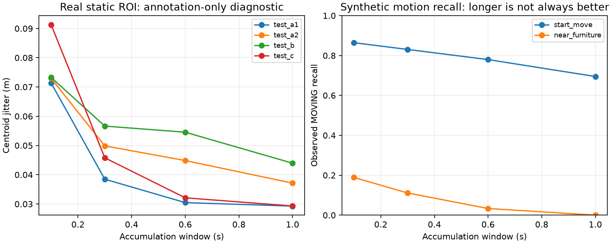

# Phase 5A experiments — 2026-11-11

**Outcome:** reusable scene accumulation, background map, filtered boxes and a compatible
renderer interface are implemented and tested. Real diagnostic results are mixed and do
**not** establish more reliable overall perception. Keep the original operational defaults.
No held-out recording or live robot validation was performed for this implementation.

Full numeric tables: [STABLE_LIDAR_RESULTS.md](STABLE_LIDAR_RESULTS.md).
Machine-readable aggregates, annotation/baseline hashes and all event delays:
[STABLE_LIDAR_METRICS.json](STABLE_LIDAR_METRICS.json). These contain no per-frame private
scene geometry. Raw recordings, JSONL scene outputs and annotations remain gitignored.



## Provenance and environment

Branch `phase5-stable-lidar-perception`, integrated base
`9068088542067fc117535279b412fbf2f808fdf6` from `phase3-visual-groundtruth`, preserving
Phase 3.8 and Phase 4.1. Interface published before perception at
`5e269061c3da70ffe3d00798eb9bf05977869797`; handoff note at
`096bc924752ac82de33e01ca8c20b76e8e90065b`. No merge into main.

Executed on macOS ARM64, Python 3.12.11, NumPy 1.26.4, SciPy 1.15.2, Open3D 0.19.0,
PyTorch 2.6.0, pytest 8.3.5, jsonschema 4.26.0, Matplotlib 3.11.2, Ruff 0.11.2.
No new neural model or dependency for runtime scene processing. JSON Schema validation is
now an explicit test extra. Matplotlib is only required for the optional aggregate report.

The original shared `.venv` Python base under `/private/tmp` had expired. Execution used a
fresh isolated Python 3.12.11 runtime in the Phase 5A worktree, reading the existing pinned
site-packages through a local `.pth`; Claude's environment was not modified. This verifies
the code in the existing dependency environment, **not a new clean installation**. New
checkouts should create their own environment with the documented commands below; do not
reproduce workstation-specific `.pth` paths.

## Actual scan audit

Audited all 3,926 `cloud_base` frames: A1=925, A2=769, B=1,001, C=1,231. Every frame contains
per-point second offsets. Median message spacing is about 65 ms; median acquisition span
about 62.3 ms. Some point times are not sorted. Consecutive XYZ overlap rounded to 0.1 mm
has p95 zero, consistent with changing samples, not identical complete scans. This does
not prove independence of adjacent returns or uniformly sampled 360-degree coverage.

Earlier adapter evidence identifies `cloud_deskewed` as an odom accumulation with a
10,000-point carryover, roughly 89% overlap; do not accumulate that topic again. The
existing 0.3 s window typically contains five incremental messages. Extending its duration
without changing its old max_frames=10 cap would stop at about 0.6 s. New 0.1/0.3/0.6/1.0 s
windows contain median 2/5/10/16 acquisition intervals.

Within-message endpoint-pose displacement sensitivity (p95 across framewise p95 point
displacements) is 0.00096/0.00088/0.00090/0.09817 m for A1/A2/B/C. C therefore has substantial
potential motion distortion. These are **sensitivity estimates, not observed distortion
errors or proof that point-level deskew is correct**. Firmware instantaneous point-frame
semantics during motion remain unverified. Real replay uses midpoint pose, retaining exact
acquisition-time metadata; only synthetic tests exercise enabled point-level deskew.

## Window diagnostic and profile decision

Sampling every fifteenth real scan, A1 mean occupied 0.05 m voxels rise from 1,419 to 3,257,
5,031 and 6,704 for 0.1/0.3/0.6/1.0 s. A1 centroid jitter in the annotated static ROI falls
from 0.0714 to 0.0385/0.0305/0.0293 m. Corresponding endpoint jitter reductions are A2
0.0730→0.0371, B 0.0733→0.0439, C 0.0913→0.0293 m. A1 mean azimuth-bin coverage rises only
from about 25.8 to 26.9 of 36 bins. Angular occupancy is not 3D surface completeness.
A1 window-build mean latency grows from 0.86 to 2.72/8.01/14.89 ms.

**Oracle diagnostic:** the annotated static polygon and height band select points only
for these post-accumulation measurements. This is not segmentation success and no such
annotation mask is passed to runtime. ROI shape/point counts are recorded in the aggregates.

The opt-in profile retains 1.0 s of acquisition history, uses 0.1 s for object proposals
and a separate 2.0 s TTL background map. The short object horizon is supported by the
synthetic reaction-speed comparison below, but the real coverage loss means it is only
an experimental candidate. The longer background lifetime itself is not an optimized or
validated navigation setting. No operational profile is changed.

## Synthetic comparison

Six seeded scenarios, 90 frames each at 0.065 s, generated by `scene.synthetic` (seed 17):
alternating partial sampling, robot rotation, robot translation, stationary object starting
to move, moving person near furniture, and sparse returns with explicit occlusion. Truth
is generated independently and consumed only by evaluation. Perception uses no oracle mask.
Baseline uses unchanged existing LidarProcessor/MultiObjectTracker with a 0.3 s odom window;
ground height is adapted to the synthetic world. Both methods count currently supported
births (including tentative baseline tracks), and separate stale estimates.

- Start-moving motion recall: original 0.780; new windows 0.864/0.831/0.780/0.695.
  Motion activation delay: original 0.845 s; new 0.520/0.650/0.845/1.170 s.
  Detection delay is zero because the stationary object is already present.
  Mean dimension error increases from 0.124 m at 0.1 s to 0.275 m at 1.0 s, consistent
  with moving-object smearing. These are one deterministic scenario, not statistical claims.
- Rotation/translation show finite stable geometry with exact pose compensation. Longer
  windows lower jitter, but the new 0.1 s profile does not beat the original on all cases.
- Alternating sampling: original jitter 0.00878 m versus new 0.00993 m at 0.1 s; worse.
- Near-furniture remains unresolved: coverage 0.711 at 0.1 s, dropping to 0.622 at 1.0 s;
  moving recall 0.189→0.0. Original recall is also zero. Better presentation does not
  establish correct physical object separation.
- Sparse/occlusion coverage on visible truth is 0.988 at 0.1/0.3 s and 1.0 at 0.6/1.0 s.
  Occluded geometry is explicitly stale, never refreshed solely by old window points.

All horizon/scenario geometry, dimension, duplication, merge, velocity, delay and runtime
metrics are in the JSON. No synthetic model accuracy or real-world generalization is claimed.

## Real annotated comparison

A1, A2, B and C are **development/diagnostic recordings only**. Their LiDAR-derived
annotations were reviewed by Claude on diagnostic sheets but not verified by a human.
C includes registration compensation in annotations. Neither identities nor absolute
positions are metrology-grade ground truth. No H1–H3 held-out recordings were available.

Original cached baseline comes from `ecfaae38984a598a9839b17582c31be42532972d`, using
original 0.3 s input windows. New replay processes all 3,926 raw scans, including one
missing-pose output each for A1 and C (none for A2/B). Source midpoint timestamps align comparison frames.
For each object both methods have the same scorable denominators: A1 box 916; A2 box
557/person 495; B box 632/person 555; C box 938.

This is a **combined pipeline comparison**, not an isolated accumulation ablation: original
ground RANSAC uses 200 iterations versus new 100; compact filtering, smoothing and motion
logic also differ. Synthetic baseline retains current existing implementation, whereas real
baseline is the historical cached original. Do not equate those two baseline provenance paths.

Matching ignores identity and uses per-frame Hungarian assignment, 0.5 m to a person point
or 0.15 m to the static polygon. Geometry coverage counts fresh matched estimates only.
Availability additionally allows stale held boxes and is not current observation evidence.
False MOVING is conditional on matched stationary truth; moving recall includes **all**
scorable moving truth, including misses. Velocity error and jitter are conditional on
matches. Jitter is XY residual standard deviation relative to annotated region/point;
smaller error on a much smaller matched subset is not overall accuracy improvement.
Longest supported run breaks after 0.2 s gaps and is divided by all scorable frames.

Key new results versus original:

- Box fresh coverage A1 0.854→0.171, A2 0.758→0.129, B 0.677→0.090, C 0.693→0.381.
  New box availability including stale is 0.886/0.804/0.555/0.982 respectively.
- Person fresh coverage A2 0.735→0.455 and B 0.905→0.499. New availability is 0.939/0.923,
  but moving recall falls from 0.620→0.121 and 0.575→0.058. This is a serious regression.
- Static box false MOVING falls to zero among matched boxes in these four recordings.
  A1/B/C box jitter improves from 0.101/0.100/0.089 m to 0.048/0.046/0.051 m;
  A2 worsens from 0.077 to 0.084 m.
- Person mean velocity error falls A2 0.458→0.371 m/s, B 0.399→0.300 m/s, conditional on
  matches. This does not compensate for missing moving people.
- Background merges decline largely by **turning into no-cluster misses**. For A1 the
  background-merge count drops 131→0, but no-cluster increases 1→759 of 916 frames.
  C drops 308→2 merges while no-cluster rises 3→584 of 938. Report both, not only merges.
- Roughly 69% of all emitted scene boxes are stale, versus 44–47% original. This fraction
  includes unannotated scene objects; it is not a precision/false-positive estimate.
- New per-frame compute mean is 18.3–21.2 ms, p95 19.9–26.8 ms. This excludes JSON
  validation/serialization, file I/O and live transport; no real-time throughput claim.
  Cached original latencies are tracker-only, so no comparable real end-to-end speedup is claimed.

Real event delays are relative to annotation moving-label onset, not externally measured
physical motion onset. The JSON records every event and marks left-censored starts after
gaps. Null delay means not detected/recalled in that event, never zero. Many events never
activate MOVING. Successful new A2 activations range about 0.78–1.88 s; B about 0–1.62 s.
Zero can reflect an existing MOVING label at a newly annotated event. Averaging only these
successful events would hide failures; use event list and recall together.

## Verification and reproduction

From the dedicated branch/worktree, create a supported environment:

```bash
uv venv --python 3.12 .venv
uv pip install --python .venv/bin/python -e '.[test,forecasting]'
export PYTHONPATH=src
export MPLCONFIGDIR=/tmp/go2-matplotlib
.venv/bin/python -m pytest -q
.venv/bin/python scripts/read_scene.py tests/fixtures/scene/renderer.jsonl
.venv/bin/python scripts/benchmark_stable_scene.py --output data/outputs/phase5/synthetic_release
```

Real commands actually executed (private inputs exist only on this workstation):

```bash
export PYTHONPATH=src
RECORDINGS=/Users/yushan/Desktop/Go2_Navigation/data/recordings
ANNOTATIONS=/Users/yushan/Desktop/Go2_Navigation/data/annotations
COMPARISON=/Users/yushan/Desktop/Go2_Navigation/data/outputs/mac/tracker_comparison
.venv/bin/python scripts/inspect_lidar_scans.py --recordings "$RECORDINGS" --output data/outputs/phase5/scan_audit.json
.venv/bin/python scripts/benchmark_lidar_windows.py --recordings "$RECORDINGS" --annotations "$ANNOTATIONS" --output data/outputs/phase5/window_audit.json
for name in test_a1 test_a2 test_b test_c; do
  .venv/bin/python scripts/run_stable_scene.py --input "$RECORDINGS/$name" --output "data/outputs/phase5/release/$name"
done
.venv/bin/python scripts/evaluate_stable_scene_real.py --annotations "$ANNOTATIONS" --comparison "$COMPARISON" --scenes data/outputs/phase5/release --output data/outputs/phase5/release_real_metrics.json
.venv/bin/python scripts/report_stable_scene.py
```

Use new output directories for reruns; replay and benchmark refuse to overwrite. Report
script intentionally regenerates aggregate documentation from completed JSON results.
Actual final replay used the implicit default `current_support_min=3`; YAML now makes that
same value explicit. Baseline cache creation is documented in TRACKING_GROUND_TRUTH.md.

Verification on this environment: **310 passed, 1 hardware skipped (39.65 s)**. Tests cover
transforms, verified synthetic deskew, provenance, clock/reset/missing poses, map expiry,
changing partial samples, motion onset and sparse observations, occlusion, conflicting
measurements inside old boxes, old-point freshness, finite geometry, machine schema and
fresh-vs-stale evaluation. All previous tests remain included.

Ruff 0.11.2 was run over the complete repository: **33 existing findings**, confined to
unchanged hardware scripts `lidar_diag.py`, `lidar_state.py`, `test_camera.py`, `test_lidar.py`.
They are not silently fixed in Claude-owned hardware work. Phase 5A files pass scoped lint:

```bash
uvx --from ruff==0.11.2 ruff check .
uvx --from ruff==0.11.2 ruff check src/go2_perception/scene scripts/*stable_scene*.py scripts/benchmark_lidar_windows.py scripts/inspect_lidar_scans.py scripts/generate_scene_fixture.py scripts/read_scene.py tests/test_scene*.py tests/test_stable_scene.py
```

Remaining work: human annotation review and held-out two-object recordings; verify firmware
point-frame timing under motion; improve compact-object coverage before tuning motion
thresholds; measure overlap/occlusion separation and uncertainty calibration; benchmark
end-to-end replay cost; coordinate renderer consumption with Claude. No live robot,
calibration, held-out robustness or navigation safety validation is claimed.
