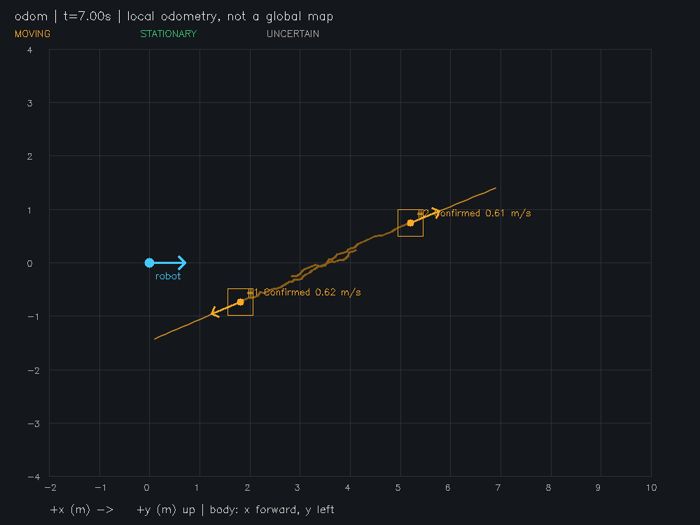

# Phase 3 evaluation — 2026-11-06

## Phase 3.6 evaluation update (2026-11-07)
Current robustness branch is based on macOS validation `ecfaae3`, not the older main below.
Baseline source suite: 135 passed/1 hardware skipped; new suite: **161 passed/1 skipped in 12.04 s**.
All 26 new regressions and existing adapter/perception tests pass. Forty controlled scenarios
(seeds 36, 7, 13, 42) compare the Git baseline with the opt-in profile on identical detections.
ID switches total 61→7; seed 42 still fails complete split recovery. Dwell worsens brief-stop
recall. These tests use a .5 m planar matching gate, unlike the historical 1 m evaluation below.
See [TRACKING_ROBUSTNESS](TRACKING_ROBUSTNESS.md) for protocol, per-case tables, real local replay,
latency caveats and reproduction; [aggregate synthetic JSON](TRACKING_ROBUSTNESS_METRICS.json)
includes every metric and input digest. No new live robot tests were performed. Historical
results below and Claude's PHASE3_REAL_VALIDATION remain available without replacement.

Branch `phase3-tracking`, based on integrated `main` at `dc0f85b`. No training, movement
commands, new runtime dependencies, or hardware revalidation was performed.

Local A1/A2/B/C replay completed on 3,924 pose-valid frames. Created IDs fall from
514/464/624/699 to 261/243/333/334, but ROI competition and latency increase. These are
unannotated proxies, not real tracking accuracy. See the aggregate real report linked in
TRACKING_ROBUSTNESS; no private sensor samples are committed.

## Tests and environment
macOS ARM64, Python 3.12.11; original pinned dependency versions unchanged, including
NumPy 1.26.4, SciPy 1.15.2, OpenCV 4.11.0.86, Open3D .19.0, PyTorch 2.6.0,
Ultralytics 8.3.100, pytest 8.3.5; optional PyAV 17.1.0 already installed for Phase 2 tests.
Baseline before implementation: **70 passed, 1 hardware test skipped in 6.08 s**.
Phase 3 suite: **127 passed, 1 hardware test skipped in 7.13 s**. All original tests retained.
New tests cover Kalman covariance/prediction/update, timestamps, gates/classes/duplicates,
track lifecycle/reacquisition, full rigid ego transforms and moving objects, stale/missing
poses, motion uncertainty, trajectories, replay parsing/CLI, real cloud compatibility,
metric identity counting, single/window raw replay with synthetic roll/pitch/yaw (guarding
against double levelling), and all eight synthetic scenarios. New-code Ruff checks passed.

Development initially exposed noisy outliers creating duplicate IDs and consecutive-hit
confirmation failing sparse data. The final settings use a wider squared innovation gate,
conservative nearby-birth suppression, and three recent hits within one second. The results
below use those settings; additional seeds were evaluated without further tuning.

## Commands actually executed
```bash
.venv/bin/python -m pytest -q --tb=short
# macOS editable .pth hidden-flag workaround, documented in SETUP.md:
UV_CACHE_DIR=/private/tmp/go2-uv-cache uv pip install --offline --python .venv/bin/python --reinstall-package go2-dynamic-perception '.[test]'
.venv/bin/python scripts/generate_tracking_test_data.py
.venv/bin/python scripts/evaluate_tracking.py --input data/sample/tracking_sequence --output data/outputs/phase3/metrics.json
.venv/bin/python scripts/run_tracking.py --input data/sample/tracking_sequence/crossing --output data/outputs/phase3/crossing --video
.venv/bin/python scripts/run_tracking.py --input data/sample/tracking_sequence/ego_motion --output data/outputs/phase3/ego_motion
.venv/bin/python scripts/run_tracking.py --input data/sample/tracking_real_fixture --mode fixed_sensor --output data/outputs/phase3/real_fixture
```
Use fresh output directories on rerun; the CLI refuses overwrites. Generator creates eight
80-frame scenarios with explicit synthetic acquisition times, full robot poses, and odom GT.
A stationary object, translating/rotating ego platform, one moving object, two crossing objects,
0.6 s occlusion, irregular 0.06–0.2 s spacing, Gaussian measurement noise, and detections every
third frame are covered. Default seed=13; noise sigma=.035 m, or .15 m for the noisy case.
No RGB accuracy or sensor performance is measured by these detection-level simulations.

## Synthetic reference results (seed 13)
| Scenario | XY position MAE (m) | XY velocity MAE (m/s) | Continuity | ID switches | Init delay (s) | IDF1 | Tracker ms/frame |
|---|---:|---:|---:|---:|---:|---:|---:|
| crossing | 0.0181 | 0.0558 | 97.50% | 0 | 0.200 | 0.9873 | 0.893 |
| ego_motion | 0.0185 | 0.0557 | 97.50% | 0 | 0.200 | 0.9873 | 0.413 |
| irregular | 0.0187 | 0.0496 | 97.50% | 0 | 0.361 | 0.9873 | 0.483 |
| moving | 0.0183 | 0.0549 | 97.50% | 0 | 0.200 | 0.9873 | 0.427 |
| noisy | 0.0598 | 0.1164 | 97.50% | 0 | 0.200 | 0.9873 | 0.424 |
| occlusion | 0.0188 | 0.0550 | 91.25% | 0 | 0.200 | 0.9542 | 0.427 |
| sparse | 0.0252 | 0.0521 | 62.50% | 0 | 0.600 | 0.7692 | 0.193 |
| stationary | 0.0183 | 0.0549 | 97.50% | 0 | 0.200 | 0.9873 | 0.435 |

Exact results: [TRACKING_METRICS.json](TRACKING_METRICS.json).
Position/velocity MAE are mean absolute **coordinate** errors across x/y over spatially matched
confirmed outputs. Matching is one-to-one Hungarian with a 1 m XY gate. Errors include
initialization transients; tentative/lost outputs are excluded. Continuity is matched confirmed
GT-frame pairs / all GT-frame pairs, including occluded frames. Lost tracks retain identity but
reduce this metric. ID switches compare successive matched IDs for each GT object, including
across gaps. Initialization delay is first confirmed match minus first GT timestamp; counts of
initialized and total objects are also reported, so never-initialized objects are not concealed.
IDF1 uses global one-to-one identity assignment maximizing within-gate frame overlaps, with
IDF1=2*IDTP/(total GT frames + total confirmed prediction frames). This uses 3D tracking's planar
distance gate, not an image benchmark's box-IoU protocol; do not compare it directly to MOTChallenge
leaderboards. Empty/unannotated sequences never produce fabricated accuracy statistics.

## Additional noisy-seed validation
Ran all eight scenarios for seeds 1, 2, 3, 21 and 42: **40 sequences, 3200 frames**.
Max per-sequence position MAE=.06143 m; max velocity MAE=.15582 m/s.
**Four ID switches** occurred: stationary, moving, occlusion and noisy scenarios with seed 3
(one each); other sequences had zero. These are known baseline association failures after
outliers, not hidden successes. No parameters were changed after this run. Full results:
[TRACKING_STRESS_METRICS.json](TRACKING_STRESS_METRICS.json). Reproduce each seed with
`generate_tracking_test_data.py --seed N --output data/sample/tracking_seedN` followed by
`evaluate_tracking.py --input data/sample/tracking_seedN --output data/outputs/seedN.json`.

## Visualization and measured runtime
Crossing demo: 80 frames, .744 s end-to-end after imports, **107.5 frames/s** including PNGs,
JSONL and MJPG video; mean tracker latency .913 ms. Reference evaluation tracker-only means
span .193–.893 ms/frame (approximately 1120–5172 updates/s for one/two objects). These are short
local CPU measurements, not live Go2 throughput or a latency guarantee.
Ego-motion demo: 80 frames, .452 s, 176.9 frames/s with PNGs and JSONL. Its BEV shows the moving
robot and stable odom object. Crossing and ego-motion frames were visually inspected.
Video was decoded back through OpenCV: **80 frames, 10 fps**, confirming the export is readable.
The AVI is display-paced; its timestamp overlays remain acquisition-time values.



## Offline real-data validation (limited)
The only available non-private fixture, `tests/fixtures/go2/real_cloud_pair.npz`, is a
same-time raw/body cloud pair, **not a temporal sequence**. Its original `base_xyzi`, `base_time`
and `stamp` were packaged with RecordingWriter into `data/sample/tracking_real_fixture`.
Unknown receipt time was stored as null; no odometry or timestamps were fabricated.
Fixed-sensor replay processed one frame and emitted **4 tentative UNCERTAIN tracks** in
`fixed_sensor:base_link`, plus JSONL and PNG. Runtime includes first Open3D import: .979 s;
tracker 1.58 ms. This verifies loading/perception/tracker compatibility only. It cannot establish
velocity, world-frame motion, real ID continuity, or detection accuracy. Tests also verify that
this recording is rejected in odometry mode without poses. No ground-truth metrics were reported.
Private Phase 2 multi-frame recordings are not available on this workstation.

## Live validation and limitations
No Phase 3 live tests; the hardware test remains skipped. Prior Phase 2 hardware evidence is
preserved, but does not validate tracking while walking. Required next evidence: recorded
body-frame clouds plus bracketing odometry under known robot/object motion and annotated IDs.
Real RGB–LiDAR fusion remains blocked by calibration and synchronization. Further limitations:
centroid/box changes from partial visibility, cluster merge/split, identical crossings, outlier
fragmentation, pose error/drift, no appearance/re-identification, no vertical velocity, and
constant-velocity-only forecasting. Filter uncertainty omits pose and detector bias/correlation.
Windows compensate ego motion per frame, smear moving objects, and correlate observations.
These limitations preclude claims of navigation readiness or real-world tracking accuracy.

Final checks: `uv pip check --python .venv/bin/python` reported all 78 packages compatible;
`git diff --check` and compilation of new modules/scripts passed. A diff against main confirmed
no changes to the original RGB/LiDAR/fusion/I/O/Go2 adapter implementations or dependency pins.
