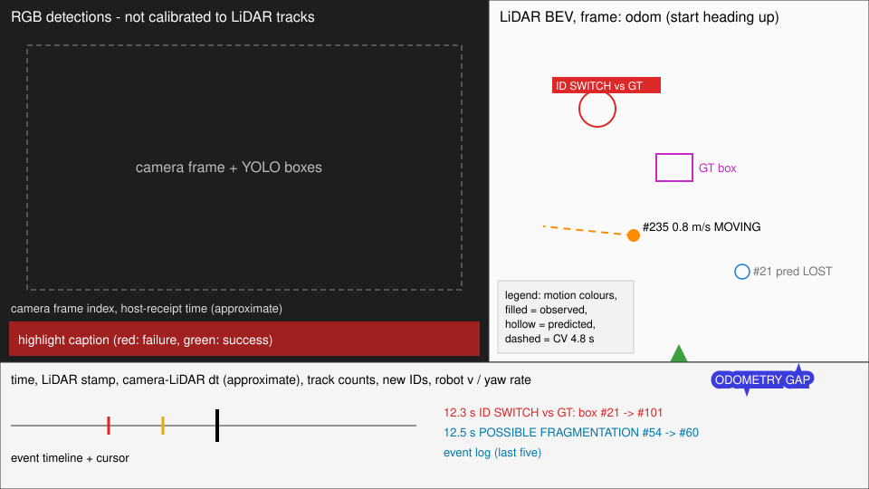

# Diagnostic videos and annotation editing — Phase 3.8 visual ground truth (2026-11-09)

Branch `phase3-visual-groundtruth`: the Phase 3.8 ground-truth work (`79bb0f9`) plus a merge
of `phase4-social-forecasting` (`5979a76`, which contains Phase 4 `447f164`). The merge adds
the forecasting code and documents only; no tracker configuration or default changed.

The videos show real camera frames from a private home. They are written only to the
Git-ignored `data/outputs/mac/videos/`; the renderer refuses any path Git would track. Nothing
in this document embeds imagery.

## What a video frame shows (1920 × 1080, H.264, 15.4 fps = real time)


**Left: camera.**
- The recorded RGB frame, with YOLOv8n boxes (class and confidence ≥ 0.3) from
  `go2_replay.py`.
- Camera frame index and camera time.
- The header **"RGB detections — not calibrated to LiDAR tracks"**. No LiDAR track or
  ground-truth ID is drawn in the camera view: there is no camera calibration.
- In highlight clips, a caption: red for failures, green for successes and comparisons.

**Right: LiDAR bird's-eye view in `odom`.**
- The view is rotated so the start heading points up; the angle is printed in the header. The
  axes are still odom metres, on a 1 m grid.
- Gray dots: raw `cloud_base` points of the tracker's 0.3 s window, about 0.25 m below to 1.2 m
  above base height. Gray boxes: the clusters (detections) the tracker received.
- Green: the robot pose and path from odometry.
- Tracks:

  | Mark | Meaning |
  |---|---|
  | blue / orange / gray | STATIONARY / MOVING / UNCERTAIN |
  | filled circle | Confirmed and observed this frame (a detection supported the position) |
  | hollow circle, label `pred` or `pred LOST` | coasting or Lost: the drawn position is the filter **prediction**, not a measurement |
  | small square | Tentative |
  | line behind a track | its last 3 s; solid where observed, thin gray where coasting |
  | arrow | velocity, drawn as the distance covered in 1 s |
  | dashed line | constant-velocity future, 12 × 0.4 s = 4.8 s; only for observed tracks faster than 0.2 m/s |
  | faded marks, no label | tracks that are never matched to an annotated object (walls, clutter) |

- Magenta: annotation. A cross for a person, a polygon for the box, and the status line
  "GT: person visible/moving, box partial/stationary". It comes from LiDAR and was reviewed
  as described in [TRACKING_GROUND_TRUTH](TRACKING_GROUND_TRUTH.md).
- Event markers (circle plus tag) stay for 1 s: red when supported by the annotation, amber
  for a heuristic.

**Bottom: status.**
- Time since the first LiDAR frame, the LiDAR stamp (go2_robot clock), and the camera−LiDAR
  offset labelled *approximate sync*.
- Confirmed / lost / tentative track counts, and new Confirmed IDs this frame.
- Robot speed and yaw rate from the `robot_odom` message nearest in time (within 0.1 s).
- Warnings: CAMERA MISSING, NO POSE, ODOMETRY GAP.
- A whole-recording event timeline with a cursor (red: ID switch vs annotation; amber:
  warning), and the last five events.

## Events: confirmed versus suspected
| Event | Source | Meaning |
|---|---|---|
| `ID SWITCH vs GT: box #a -> #b (proposals: …)` | annotation (red) | The matched track ID of an annotated object changed (CLEAR-MOT matching, `evaluate_ground_truth.py`). The proposal state at the change is shown. Exits from view are not listed. |
| `UNCERTAIN MOTION` | annotation (red) | The annotated person is walking but the matched track stayed UNCERTAIN for 1 s |
| `NEW TRACK #id` | heuristic (amber) | A track became Confirmed and later stayed Confirmed ≥ 1 s |
| `TRACK #id LOST` / `ENDED` | heuristic | Unobserved for 5 frames (about 0.33 s) / removed by the tracker |
| `POSSIBLE FRAGMENTATION #a -> #b` | heuristic | A new track within 0.6 m of one that was lost or ended within 1.5 s |
| `POSSIBLE ID SWITCH #a -> #b` | heuristic | Same, but the old track is still coasting |
| `POSSIBLE DUPLICATE #a / #b` | heuristic | Two observed Confirmed tracks within 0.3 m for 3 frames |
| `ODOMETRY GAP` | data | Odometry messages more than 0.1 s apart, or a LiDAR frame skipped for lack of bracketing odometry |

Heuristic events cover only tracks matched to an annotated object at some time. Without
annotations they cover tracks Confirmed for 3 s within 3.5 m of the robot. Heuristics are never
called confirmed. The annotation is LiDAR-derived, and no human has verified it (see the
ground-truth report). "Confirmed" therefore means "against these annotations".

Event counts for the original tracker, from `data/outputs/mac/videos/*_events.jsonl`:

| Recording | ID switch vs GT | Possible fragmentation | Possible ID switch | Possible duplicate | Track lost | Odometry gap |
|---|---:|---:|---:|---:|---:|---:|
| A1 | 30 | 6 | 5 | 0 | 70 | 1 |
| A2 | 26 | 9 | 3 | 0 | 62 | 0 |
| B | 37 | 3 | 1 | 1 | 44 | 0 |
| C | 15 | 9 | 2 | 0 | 60 | 1 |

## Timestamps and synchronisation
- **Master clock: LiDAR.** One video frame per tracker frame, at the LiDAR acquisition midpoint
  on the go2_robot clock, played at 15.4 fps (real time).
- **Camera frames carry host-receipt time only.** They are mapped to the robot clock with
  the median `host_recv − stamp` of the odometry stream; the nearest camera frame is shown.
- **Missing frames.** If no camera frame lies within 0.15 s, the panel shows CAMERA FRAME
  MISSING; a far frame is never stretched to fill the gap.
- **Measured offsets.** The nearest camera frame is a median 15 ms and a p95 33–34 ms from the
  LiDAR stamp (maximum 92–137 ms). Frames with no camera image: A1 15/924, A2 2/769, B 5/1001,
  C 24/1230.
- **Approximate only.** Camera exposure latency and the
  network delay of each stream are unmeasured, so pairing is not frame-exact. Do not read
  camera/LiDAR coincidences finer than about 0.1 s.
- **Camera boxes are camera-only.** No detection is spatially associated with LiDAR, because no
  camera intrinsics or extrinsics are calibrated.

## Videos produced (local, private)
All are in `/Users/yushan/Desktop/Go2_Navigation/data/outputs/mac/videos/`:

| File | Content |
|---|---|
| `test_a1_original.mp4` (60 s) | Static box, original tracker: jitter of #13, flicker with duplicate tracks when the cases merge with the counter cluster, rare MOVING labels |
| `test_a2_original.mp4` (50 s) | Person near the box: person fragments into several IDs, box ID changes while the person is in front |
| `test_b_original.mp4` (65 s) | Walking person: three passes, pauses, velocity arrows, constant-velocity forecasts, fragmentation |
| `test_c_original.mp4` (80 s) | Robot turned and walked by hand: robot path and heading; the box sweeps across the robot frame but stays put in odom; ID changes after merges |
| `test_*_compare_3variants.mp4` | Original / Phase 3.6 / Phase 3.7 BEVs side by side, at a shared timestamp and scale |
| `test_b_forecast_cv.mp4`, `test_a2_forecast_cv.mp4` | Forecast overlay, every 2 s, held 4.8 s: CV from annotated history (magenta dashed) and from identity-validated tracker history (cyan dashed), against the annotated future (magenta dots, for evaluation only) |
| `highlights.mp4` (70 s) | Nine captioned clips: three successes, four failures, one variant comparison and one forecast; clips are in `highlights_clips/` |
| `*_events.jsonl` | Event logs with time, kind, text and the GT-supported flag |

Every file was checked with `ffprobe` (h264, yuv420p, 1920×1080, expected duration). macOS
QuickLook (`qlmanage -t`) generated a thumbnail for all 11 videos, so the system frameworks
decode them. Open them with QuickTime or `open FILE.mp4`.

## Regenerate
Prerequisites: the recordings, the shared cache `data/outputs/mac/tracker_comparison/inputs`,
tracker runs in `data/outputs/mac/ground_truth_eval/tracks`, the annotation cache and
annotations in `data/annotations/`, and YOLO outputs in `data/outputs/mac/test_*_replay/`.
Commands for all of these are in [TRACKING_GROUND_TRUTH](TRACKING_GROUND_TRUTH.md). Test C's
YOLO run was added in this phase:
```bash
PYTHONPATH=src .venv-go2/bin/python scripts/go2_replay.py --recording data/recordings/test_c --output data/outputs/mac/test_c_replay --no-lidar --device mps
```
Videos (about 15 s each, 30 s for comparisons):
```bash
V=data/outputs/mac/videos
for r in test_a1 test_a2 test_b test_c; do
  PYTHONPATH=src .venv-go2/bin/python scripts/render_tracking_video.py --recording $r --output $V/${r}_original.mp4 --events-out $V/${r}_original_events.jsonl
  PYTHONPATH=src .venv-go2/bin/python scripts/render_tracking_video.py --recording $r --compare baseline improved refined --output $V/${r}_compare_3variants.mp4 --events-out $V/${r}_compare_events.jsonl
done
PYTHONPATH=src .venv/bin/python scripts/forecast_ground_truth.py
for r in test_b test_a2; do
  PYTHONPATH=src .venv-go2/bin/python scripts/render_tracking_video.py --recording $r --forecasts data/outputs/mac/forecasting_gt/overlay.json --output $V/${r}_forecast_cv.mp4
done
PYTHONPATH=src .venv-go2/bin/python scripts/render_highlights.py
```
Useful options:
- `--variant improved|refined`: render another profile.
- `--start/--end`: a clip.
- `--still T`: one PNG frame.
- `--banner` and `--title-card`: captions.
- `--no-ground-truth`: hide the annotations.

## Editing annotations by hand
Corrections never edit proposals in place. They become `review` entries in
`data/annotations/specs/<recording>.json`, stored with reviewer and note, and
`annotate_ground_truth.py propose` re-applies them every time. Tracker output is shown for
orientation only; nothing copies it into the annotations.

**Interactive window:**
```bash
PYTHONPATH=src .venv-go2/bin/python scripts/annotation_editor.py --recording test_b --reviewer YOUR_NAME
```
It shows the same composite as the video. Keys:

| Key | Action |
|---|---|
| a / d | previous / next frame |
| A / D | back / forward 15 frames (≈1 s) |
| Tab | select the next object |
| click in the BEV | set the selected person's position in odom (adds the object here if it has no state) |
| 1 / 2 / 3 / 4 | visible / partially occluded / fully occluded / out of view |
| m / s / n | moving / stationary / no motion label |
| h / e / l | confidence high / medium / low |
| u | toggle **unidentifiable** (`identity_uncertain`): the state is excluded from scoring instead of guessed |
| x | drop the state |
| r | rename the identity; type it in the terminal (for example `person_2` if a second person appears) |
| b | mark a range start; the next edit applies from the mark to the current frame |
| w | save and re-propose |
| q | quit (unsaved edits are saved) |

New identities are added to the spec as `manual` objects. The edit logic is unit-tested
(`tests/test_diagnostic_video.py`). The window itself was not opened during development,
because it would appear on the user's screen; please report any problem with the keyboard
handling.

**Spreadsheet round trip** (no window):
```bash
PYTHONPATH=src .venv-go2/bin/python scripts/annotation_editor.py --recording test_b --export-csv data/annotations/edit/test_b.csv
# edit status / x / y / motion / confidence / identity_uncertain / note; add rows for new objects
PYTHONPATH=src .venv-go2/bin/python scripts/annotation_editor.py --recording test_b --import-csv data/annotations/edit/test_b.csv --reviewer YOUR_NAME
```
- Only changed cells become review entries. An unchanged export re-imports as zero entries.
- Box regions are not edited in the CSV.
- Exports contain private positions, so the tool refuses tracked paths.

## Verified versus unverified
- **Verified:**
  - Videos decode and have the expected size, codec and duration.
  - Every overlay is drawn from recorded data or tracker output.
  - Event times match the evaluation output.
  - Synthetic tests cover alignment, missing camera and odometry frames, lost/coasting drawing,
    trail persistence, the forecast overlay, H.264 export, privacy paths and annotation editing.
- **Unverified:**
  - Camera exposure timing.
  - Camera calibration, so there is no camera↔LiDAR association.
  - The annotations themselves: LiDAR-derived and reviewed by Claude, with no human review yet.
  - Odometry accuracy. The C box drifts by up to 0.2 m in odom.
  - Whether YOLO "person" boxes and LiDAR person tracks refer to the same instant.
