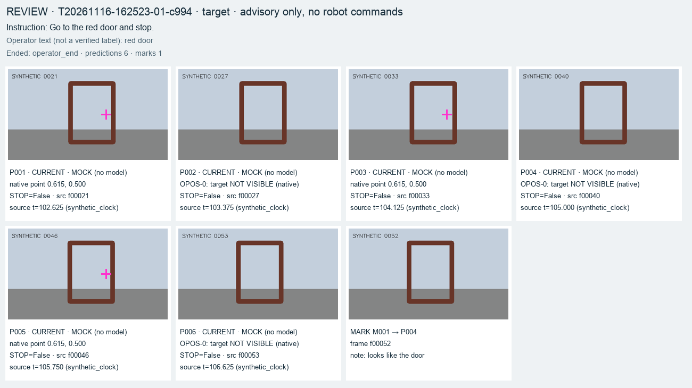

# Interactive four-panel VLN review and data collection

Branch `feature/vln-interactive-review` (worktree
`/Users/yushan/Desktop/Go2_Navigation-vln-interactive`), based exactly on
`1f93d7eff57906ce26c4b3ab4109effb4ca71edd` (`feature/vln-cached-live-validation`).
Main and the high-level motion-control PR are neither merged nor imported.

**ADVISORY ONLY — NO ROBOT COMMANDS.** The operator types a target in the terminal; a
loopback-only browser page shows the live camera, the model's native target point,
all native waypoints and headings, and a LiDAR top-down view. The operator marks what
they see, ends the trial, answers review questions, and can reopen any saved trial
with its comments later.

**Status (2026-11-17):** built and verified with synthetic fixtures, a public synthetic
recording, one private episode and the mock worker. It then ran **live, read-only, on the
stationary standing Go2 with LightNav** for one 14.5-minute session with four trials and
two operator-confirmed reviews. See [Live session](#live-session-2026-11-17). Robot
commands sent: 0.



*Synthetic imagery and a canned mock that alternates a fixed point and OPOS-0. It shows
the layout only; it says nothing about model accuracy.*

## What is reused and what is new

| Piece | Reused unchanged | New |
|---|---|---|
| Camera | `scripts/go2_camera_bridge.py` + `LiveCameraSource` (read-only multicast, measured fisheye calibration, stride 2, inbox 16) | `TapInbox`: the same bounded inbox plus a 24-frame display ring (panel A updates on the reader thread, even while a request is being prepared) |
| Observation | `Go2VLNObservation`, `ObservationInbox`, `Delivery`; no schema change | — |
| Model | `ShadowSession`, `ProcessWorker`, `vln_shadow_worker.py`, `lightnav_worker.run_job`; **full-history** reconstruction per request, cached preparation, 3 s advisory limit, stale/superseded/cancel rules | `--tensor-evidence skip` (cached mode only; default in this tool). The status file records `not_recorded_tensor_evidence_opt_in_disabled`. Defaults of `run_vln_shadow.py` are unchanged |
| Native decoding | `shadow_display.target_fraction`, `validate_proposal` | — |
| LiDAR/odom | `Go2DdsReceiver`, `PoseBuffer`, `SlidingWindowAccumulator`, 0.5 s / 1.0 s windows from `configs/go2_vln_sensors.yaml` | `scripts/go2_lidar_bridge.py` (hardware env), `vln/interactive_lidar.py` (core env), `scripts/synthetic_lidar_bridge.py` (synthetic or recorded replay, same protocol) |
| App | — | `vln/interactive_app.py`, `interactive_trials.py`, `interactive_server.py`, `interactive_page.py`, `scripts/run_vln_interactive.py` |

The experimental 8-image bounded-context policy is **not** used (`run.json`:
`temporal_policy` … "bounded-context policy NOT enabled"). Weights, prompts, temporal policy
and the 3 s advisory limit are unchanged; the limit is hard-coded, not exposed as an option.

## Launch

Use the core environment (the ignored `.venv` link points at `phase6c/core-env`). Each run
needs a **new** output directory, and it must be Git-ignored. The default is
`data/outputs/vln_interactive/run_<time>`.

Synthetic, no hardware, no model (development and demos):

```bash
cd /Users/yushan/Desktop/Go2_Navigation-vln-interactive
PYTHONPATH=src .venv/bin/python -u scripts/run_vln_interactive.py \
  --camera synthetic --lidar synthetic --backend mock --mock-pointing alternate \
  --reviewer YOUR_INITIALS
```

Recorded episode (private images, mock model):
`--camera episode --episode <…>/model_input/episode.json --backend mock`.
Recorded LiDAR: `--lidar recording --lidar-recording <go2-recording-v1 dir>` (replay
LiDAR may not be mixed with the live camera, and vice versa).

Live command, as run on 2026-11-17 (session `live_03`). It needs the operator's approval,
a stationary robot with posture confirmed, and no other heavy job on the Mac:

```bash
cd /Users/yushan/Desktop/Go2_Navigation-vln-interactive
env -u LIGHTNAV_ASSETS -u SMOLVLM_MODEL_CACHE GO2_HARDWARE=0 MUJOCO_RENDER_TEST=0 \
  HF_HUB_OFFLINE=1 HF_HUB_DISABLE_TELEMETRY=1 TOKENIZERS_PARALLELISM=false PYTHONPATH=src \
  .venv/bin/python -u scripts/run_vln_interactive.py \
  --camera go2 --lidar go2 --iface en9 \
  --hardware-python /Users/yushan/Desktop/Go2_Navigation/.venv-go2/bin/python \
  --unitree-sdk /Users/yushan/Desktop/Go2_Navigation/third_party/unitree_sdk2_python \
  --backend lightnav \
  --model-python /Users/yushan/Desktop/Go2_Navigation/data/outputs/phase6c/model-env/bin/python \
  --assets /Users/yushan/Desktop/Go2_Navigation/data/outputs/phase6c/lightnav \
  --runtime-config configs/pretrained_vln.yaml --device mps --preparation-mode cached \
  --min-free-disk-gb 10 --run-quota-gb 4 --reviewer YOUR_INITIALS \
  --output data/outputs/vln_interactive/<NEW_RUN>
```

Three launch requirements were found live:
- `--unitree-sdk`: macOS marks `.venv-go2`'s editable `.pth` files hidden, so Python 3.10
  skips them; the SDK path goes only on the LiDAR bridge's `PYTHONPATH`.
- The disk floor: 20 GiB by default; free disk was 17.7–19.7 GiB.
- **Where it runs:** started from the desktop app's terminal panel, neither bridge received
  anything (0 RTP packets, 0 DDS samples), while the same code started from the agent shell
  or a normal Terminal received everything. This is consistent with macOS Local Network
  permission being granted per app; the setting was not changed. `live_03` therefore ran
  from the agent shell with stdin from a FIFO. The operator typed through
  `data/outputs/vln_interactive/relay.sh <log> <fifo>` in the panel; the relay shows the
  log and forwards lines.

Open the printed `http://127.0.0.1:8765/` (loopback only; `--port 0` picks a free port).

### Terminal commands (`help`)

```text
target TEXT        new trial; expands to "Go to the TEXT and stop." (saved before inference)
instruction TEXT   new trial with TEXT verbatim as the instruction
mark [NOTE]        bind a mark to the prediction + camera frame the browser shows now
note TEXT          verbatim note bound to the current trial and displayed IDs
end                end the trial (advisory cancel only; no robot command) and review it
review [ID|close]  list trials, open one (contact sheet + new append-only review), or close
status             print a compact status line
save               flush records and regenerate the contact sheet
quit               end everything (no robot command is ever sent)
help               this text
During a review dialog every line is an answer; `!cancel` discards it, `!quit` quits.
```

Template `target_go_to_and_stop_v1` = `Go to the {target} and stop.` The template ID, the
operator's words and the expanded instruction are written to `trial.json` **before** the
instruction reaches the session. The operator's words are a request, never a verified
label (`operator_text_is_verified_label: false`).

Starting a new `target`/`instruction` while a trial is active ends that trial
(`superseded_by_new_trial`); it can be reviewed later with `review ID`. `end` and `quit`
call only the session's advisory `cancel` (`physical_robot_stop_sent: false`).

## Step-by-step test: one answer at a time, in the browser

The terminal-driven flow (`target`, `mark`, `end`) proved hard to use live. Output landed
in the middle of typing, answers streamed continuously, and trials ended on their own.
The default operator flow is now the **Test** box at the top of the page. The terminal is
only a log; its old commands still work for scripted use.

| Step shown | You do | What happens |
|---|---|---|
| **1 · Choose target** | type `chair`; the first time per run, tick the one safety statement; press **Ask the model** | a single-answer trial starts (`trial.json` records the instruction and your confirmation) |
| **2 · Model is answering** | keep the robot still (Cancel is available) | ~1 s of frames is collected, then **one** request; frame archiving stops |
| **3 · Your verdict** | look at the image the model saw, with its pink +, and press one button; optionally comment | point: *Yes / No / Not sure / Not in view*. OPOS-0: *Right, not in view / Wrong, it IS in view / Not sure* |
| **4 · Saved** | press **Save**; the box is ready for the next target | verdict → `human_labels.jsonl` (separate from model output); trial ends `guided_answer_saved` |

When finished, press **Close tool**; it closes only this read-only tool. Nothing waits on a
timer while you decide; a request that gets no answer within 60 s is reported and nothing
is saved. Suggested set: a visible object, an absent object, an ambiguous object.

### Live result (`live_08`, 2026-11-17)

The Go2 was standing and stationary with the remote owning control (operator-confirmed).
A read-only check showed avoidance on (`obstaclesAvoidSwitch: true`), `cloud_base` at
15.5 Hz and odometry at 162 Hz. Six tests in 304 s, all saved with the browser flow,
closed with **Close tool**. 0 robot commands, 0 camera buffer overflows, 0 receipt gaps.
Every answer was **CURRENT** (1.6–2.5 s, 5 frames each), because each test asks once
right after it starts.

| Target | Model answer | Operator verdict | Operator comment (verbatim) |
|---|---|---|---|
| bag | OPOS-0 (not visible) | right, not in view | "the bag is look like a target" |
| oven | point (0.68, 0.50) | + is on the target | — |
| dish washer | point (0.24, 0.50) | + is on the target | — |
| wine | OPOS-0 (not visible) | **wrong, it IS in view** | "It is on the dish washer" |
| microwave oven | point (0.68, 0.17) | + is on the target | — |
| sofa | OPOS-0 (not visible) | right, not in view | "Can let the Go2 turn around and check" |

Operator verdicts across six answers in one scene: 5 agreed with the model, 1 disagreed
(a missed small object). This is not an accuracy estimate. The bag comment is kept
verbatim and not interpreted.

### Guided-flow safeguards (after source review)

- A new answer immediately covers the canvas ("Loading the model's image…").
- Save stays disabled until **that** image has loaded and a verdict is chosen.
- Image-load errors keep Save disabled, and late callbacks from older answers are ignored.
- Save sends `trial_id`, `prediction_id` and the archived image SHA-256. The server
  rejects mismatched, stale, replayed or duplicate (double-click) saves.
- The card shows "status when the answer arrived" and "this image is now N s old"
  separately.
- If a terminal command, resource limit or cancellation ends the trial:
  - while asking: the box returns to step 1 with the reason;
  - while answering: the verdict on that image can still be saved, flagged
    `trial_already_ended_before_save`.
- Review-only mode hides the Test box; reopened reviews list guided verdicts
  (`choice_text`, `prediction_id`, verbatim comment) next to older review records.

## Paired-view experiment (before / manual turn / after)

Run with `--record-lidar-continuously` so odometry is also recorded between trials
(LiDAR chunks tagged `between_trials`).

1. **Before:** stationary robot, Ask "chair", save the verdict.
2. **Turn:** the operator turns the Go2 with the handheld remote in a direction they
   choose, with onboard avoidance on and clearance and cable slack checked. The app
   sends nothing.
3. **After:** robot stopped, Ask "chair" again (identical wording), save the verdict.
4. Link the pair:
   `scripts/link_paired_views.py --run <run> --before <T1> --after <T2> --operator-direction <dir> --operator-report "<words>"`

The script compares this process's host-monotonic receipt times of every archived
model-input frame with the odometry yaw (receipt converted with its own wall-minus-
monotonic sample):
- **turn start:** yaw leaves the pre-turn median by more than 2°;
- **turn end:** yaw last differs from the post-turn median by more than 2°.

It records `second_answer_uses_post_turn_view` (with margins) and appends to
`evaluation/paired_views.jsonl`. The two answers are **independent observations**: each
Ask starts a fresh instruction history. This is not continuous temporal navigation or
autonomous search. A synthetic test checks a verified pair; a too-early second Ask was
reported as not verified during development.

### First paired-view result (`live_09`, 2026-11-17)

Preflight: the robot was reachable, `cloud_base` arrived at 16 Hz, odometry at 163 Hz,
and avoidance read on (read-only `rt/multiplestate`). The operator confirmed clearance;
the cable-slack check was given as a condition in the turn instruction. 0 robot commands.

| | Before | After |
|---|---|---|
| Trial / prediction | `T20261117-210333-01-11a2` / `P001` | `T20261117-210902-02-75f6` / `P002` |
| Model output | OPOS-0 (not visible) | OPOS-0 (not visible) |
| Receipt status | STALE (2.98 s since receipt, 3.03 s since est. exposure; first request of the session includes warm-up) | CURRENT (1.98 s / 2.02 s) |
| Operator verdict | Wrong — the target IS in view | Wrong — the target IS in view |
| Operator comment (verbatim) | "The chair is partially visiable" | "The chair now is right infront of the Go2." |
| Age of the image when reviewed | 65.5 s | 26.2 s |

**The manual turn:**
- The operator chose to turn right. The note was logged at 02:06:18Z, before the turn.
- Odometry yaw changed by **−35.5°**, from 02:08:25.07Z to 02:08:34.15Z (9.1 s).
- Odometry position moved by about 0.06 m.
- The operator reported "stopped" at 02:08:48Z.
- **Uncertainty:** turn start and end depend on the 2° threshold, the 6.7 ms odometry
  sampling interval and unknown transport latency (milliseconds). Camera receipt is
  about 48 ms after exposure (single-boot estimate).
- **Post-turn verified:** the second answer's first input frame was received 28.1 s after
  the turn ended, and yaw varied 0.02° during those input frames. The first answer's
  inputs ended 290.5 s before the turn began.
- The two answers come from independent instruction histories.

**Outcome:** the operator judged the chair visible in both images, partially before the
turn and directly ahead after it. The model said NOT VISIBLE both times, so the turn did
not change the model's answer. That is one pair in one scene, with no general claim.

**Gaps in the evidence:**
- The verdicts are per image and say nothing about how much of the chair was visible
  beyond the operator's own words.
- The cable-slack check was not confirmed separately in words.
- The odometry heading is relative and drifts; no camera-to-body calibration exists.

### More paired views with obvious targets (`live_10`, 2026-11-17)

Same procedure and preflight: avoidance read on, `cloud_base` at 15 Hz, odometry at
159 Hz. For each pair the operator confirmed clearance and cable slack and chose the
direction, all logged as run notes. 0 robot commands, 0 camera losses, 0 dropped LiDAR
chunks. Every answer was **CURRENT** at receipt (1.9–2.9 s).

**Turn detection, method v2:** in the microwave pair, slow heading creep of +2.6° before
the turn crossed the 2° deviation threshold, and v1 reported a 76.7 s "turn". v2 measures
the turn as the interval where the yaw rate exceeds 5°/s over a 0.5 s window. The
post-turn check uses the union of both intervals (conservative). All pairs, including
the chair pair from `live_09`, were re-linked with v2; the earlier records stay in the
append-only file.

| Pair | Before: model / operator | Turn (odometry, v2) | After: model / operator | Post-turn input |
|---|---|---|---|---|
| chair (`live_09`) | not visible / **wrong, IS in view** ("partially visiable") | −35.5° right, 8.9 s | not visible / **wrong, IS in view** ("right infront") | verified, +28.1 s |
| oven | not visible / right, not in view | −64.2° right, 6.5 s | point (0.59, 0.46) / **correct** | verified, +43.0 s |
| microwave oven | not visible / right, not in view | −101.2° right, 15.7 s | point (0.66, 0.06) / **correct** | verified, +33.2 s |
| dish washer | point (0.49, 0.50) / **target not in view** ("This is not the dish washer. it is just a cabinet.") | +63.4° left, 2.8 s | point (0.51, 0.50) / **correct** | verified, +135.5 s |

Observations from four pairs in one scene (no accuracy claim):
- For oven and microwave, the answer changed from not visible to a correct point after
  the operator's turn.
- For the dish washer, the "before" point was a false detection on a cabinet. Both
  dish-washer points sit at the image center, so the correct "after" answer may partly
  reflect the operator centering the target.
- For the chair, the model missed it both times.

Trial and prediction IDs are in `evaluation/paired_views.jsonl` of each private run.

## Window

The header shows the mode in large type: **LIVE**, **REPLAY**, **SYNTHETIC** or **REVIEW**.
The status strip shows the trial, model state, last inference time, observation age,
recording, memory (per process, never summed with MPS), queue fill and disk.

- **A · Live camera:** the latest RGB frame with its frame ID, host-receipt time (clock and
  semantics), robot-clock stamp (NONE for live RGB, never relabelled), clock epoch, receipt
  fps, RAW/RECTIFIED, receipt gaps > 0.375 s, INTERRUPTED after 1 s of silence, and estimated
  exposure (UNKNOWN unless the configured latency model is used).
- **B · Model target:** the exact model-space input image of the displayed prediction, with
  its native point as a `+`. The image and the point come from **one** prediction record and
  are drawn together only after that image has loaded, so an old point is never drawn on a
  newer frame. OPOS-0 is shown as "model says target NOT VISIBLE" (a model claim, not proof
  of absence). The panel also shows the prediction ID, source frame ID/time/clock, age and
  CURRENT/STALE/SUPERSEDED/REJECTED (re-evaluated on every refresh). No boxes, no
  confidences.
- **C · Native waypoints:** all 10 native SE(2) waypoints and headings of the same
  prediction, with a table, in the model-local frame (metres/radians). Native STOP, explicit
  STOP code, model completion claim, "verified completion UNKNOWN" and
  `NOT EXECUTED — advisory only` are shown separately. No time base or speeds, and no
  registration to LiDAR, base or camera.
- **D · LiDAR top-down:** `base_link`, with views for the latest scan, 0.5 s and 1.0 s.
  Accumulated views appear only with odometry compensation; otherwise "UNAVAILABLE" with
  the reason. The panel shows host age, robot and host receipt intervals, azimuth/grid
  coverage (cells without returns stay UNKNOWN), pose only while odometry is fresh (≤ 0.25 s),
  robot clock epoch, sync status, gaps and refusals. The 0.3 m blind radius is shaded.

In REVIEW the contact sheet sits above the live panels. Prediction tiles carry their own
point. Clicking a tile stores an optional correction, after a browser confirmation.

## Process boundaries and clocks

| Process | Environment | Talks to | Never |
|---|---|---|---|
| `run_vln_interactive.py` | core (3.12) | owns everything below via pipes; loopback HTTP | imports no SDK/DDS/Torch |
| `go2_camera_bridge.py` | hardware (3.10) | multicast **read** socket | DDS, SDK, outgoing datagrams |
| `go2_lidar_bridge.py` | hardware (3.10) | DDS **subscribers** (`cloud_base` + receiver state topics; only odom forwarded) | publishers, clients, `cloud_deskewed` |
| `vln_shadow_worker.py` | model env | stdin/stdout JSONL | network, sensors, robot |

- **Camera:** host-receipt wall clock (`stamp_host`) and decode completion (`available_s`).
  A per-frame wall−monotonic sample maps them to this host's monotonic clock. A new bridge
  or a > 20 ms wall step starts a new epoch, which resets history.
- **LiDAR/odom:** robot-clock stamps per *robot epoch*. A backwards stamp jump > 1 s,
  a > 2 s jump in host−robot, or a new bridge process starts a new epoch. That resets
  the pose buffer, windows and offset. host−robot is the lower envelope of odom receipt
  minus stamp, **estimated** only after 50 samples in the epoch. It is display only and
  never reused across epochs or boots. A host wall-clock step discards it. With no
  valid estimate the page says "streams shown separately". There is **no RGB–LiDAR
  fusion** in any case (no measured `T_base_camera`).
- **Model:** host monotonic submit/start/end; ages as in the existing session.
- **Records:** wall UTC strings for people, host monotonic seconds for ordering. Recorded
  and synthetic sources keep their original stamps; receipt is this process's own receipt.

Rendering does not depend on inference. The camera tap and the LiDAR reader run on
their own threads; the server reads snapshots; the main loop never waits for the model
(one request in flight, one coalesced pending flag, 0.25 s minimum interval, at most
`--max-requests-per-trial`, default 6). The terminal reader is its own thread, with a
bounded 64-line queue.

## Recording (private, Git-ignored)

```text
<run>/run.json              model identity file, runtime-config hash, calibration, clocks, limits,
                            code hashes, git commit, robot_commands_sent 0
<run>/events.jsonl          app events (append-only)
<run>/session/              existing ShadowSession evidence: observations/*.vlnobs.npz (lossless),
                            requests/<seq>/ (job, snapshot, native outputs, receipt), worker/model.json
<run>/blobs/sha256/ab/<sha>.png   lossless images stored once, keyed by pixel SHA-256
<run>/lidar/chunk_*.npz + index.jsonl   ≤1 s chunks: points, per-scan stamps/receipts/seq, odom;
                            index rows carry robot/host source intervals, epoch, trial, sha256,
                            or dropped_not_recorded with the interval
<run>/trials/index.jsonl
<run>/trials/<id>/trial.json         instruction, template, temporal policy (written pre-inference)
<run>/trials/<id>/predictions.jsonl  native outputs as received (model output, never labels)
<run>/trials/<id>/marks.jsonl, notes.jsonl     verbatim operator text bound to exact IDs
<run>/trials/<id>/human_labels.jsonl          confirmed human reviews (separate file)
<run>/trials/<id>/corrections.jsonl           optional click-to-correct targets (separate file)
<run>/trials/<id>/trial_end.json, contact_sheet.png
<run>/summary.json          termination, counts, final resources + history, robot_commands_sent 0
```

- **Images once, by hash:** marked frames that are already in the session's lossless
  observation archive are referenced (path + file hash + pixel hash). Only other frames
  are written as PNG blobs. On every read the pixel hash is checked.
- **Marks:** the browser reports what it is displaying (prediction ID, camera frame ID)
  to a token-protected loopback endpoint. `mark` binds to that view when the report
  is ≤ 2 s old (`browser_reported_view`); otherwise it binds to the server's latest
  view and records `server_latest_browser_view_not_reported_recently`.
- **Review:** after `end` the terminal asks for a verbatim comment, target
  present/absent/uncertain, marking correct/wrong/ambiguous/n.a., path
  plausible/inappropriate/uncertain, stopping appropriate/inappropriate/uncertain/n.a.,
  and the reviewer. It then prints the structured record and saves it only on `yes`.
  Records are append-only; reopening adds a new review and never edits an old one.
- **Corrections:** the clicked fraction and pixel on that prediction's own input image,
  the image hash and size, and the coordinate convention (origin top-left, x right,
  y down).
- **Feedback never reaches the model** (`model_feedback: false`). The worker receives only
  instruction + causal images.
- **Tensors** are recorded only with `--tensor-evidence record`.
- **Late results** are written to the trial whose instruction revision produced them,
  labelled SUPERSEDED with the reason. The contact sheet is regenerated if that trial is
  under review.

## Bounds, rates, memory and disk

| Bound | Default |
|---|---|
| Camera inbox / display ring / bridge queue | 16 / 24 frames / 2 (existing) |
| LiDAR bridge queues | 8 scans / 256 odom (drops counted, visible as seq gaps) |
| LiDAR recorder | 1 writer, queue 4 chunks; full queue → explicit gap row |
| History | 20 s, 1024 frames per trial (then inference pauses and frame archiving stops) |
| Trial | 45 s, 6 requests, 20 trials per run, 3600 s host time |
| Resources | run quota 6 GiB, free disk ≥ 20 GiB, available memory ≥ 2 GiB, app RSS ≤ 4 GiB |

When a resource limit trips, the active trial ends (`resource_limit`), new trials are
refused and LiDAR recording stops. Nothing is deleted, and the display and review stay
available.

Rates measured live by this tool: ~7.1 Hz camera (stride 2), `cloud_base` interval median
0.065 s (~15.4 Hz), odometry ~150 Hz; see [Live session](#live-session-2026-11-17).
Synthetic sources: 8 Hz camera, 15 Hz scans, 50 Hz odom.

Measured memory (synthetic camera and LiDAR, mock worker, six 8 s trials, one process,
RSS from psutil): app parent **98.0 MiB** at start, 111.2 after trial 1, then 111.7 /
112.0 / 112.2 / 112.5 / 112.5 MiB. Growth flattens after the first trial (about
0.3 MiB per trial). Synthetic LiDAR bridge about 40 MiB. LightNav was not loaded; earlier
runs measured 11.2 GB worker RSS and 8.9 GB MPS allocated at load. Those two figures
overlap and are never added. Disk for the six synthetic trials was 78 MiB (448×256
images). Live 720p archives were about 0.94 MB per stored frame at 7.1 Hz in earlier
runs, so expect roughly 7 MB/s while a trial is active (an estimate, not a measurement
from this tool). The disk counter counts prepared-cache hard links once.

## Tests

`tests/test_vln_interactive.py`, 31 tests, no hardware, model or DDS:

- Template saved before inference.
- Target change keeps the late result with its original trial (SUPERSEDED).
- `end` cancels the advisory only; a late result is labelled `cancelled_or_closed`.
- A label ages from CURRENT to STALE at the unchanged 3 s limit, and the served image
  hash equals the recorded one.
- OPOS-0 is explicit, with no execution, time base or completion claims.
- Request, trial-time and trial-count limits; resource limit.
- Camera interruption and history limit stop archiving.
- Mark binding (browser view vs fallback), session-archive image references and hash
  checks.
- Blob dedupe and overwrite refusal.
- Review dialog: no save before `yes`, comment kept verbatim.
- Click mapping (fractions → pixels), separate storage, REVIEW only.
- LiDAR: reboot epoch, host step, bridge restart and offset reset; refusal without
  pose; latest-only fallback; ageing after the stream stops (recorded replay keeps all
  12/138 messages and original stamps).
- Bounded recorder with explicit gap rows.
- Synthetic bridge with and without odometry.
- Loopback server: token, Host check, path safety.
- Tensor opt-out.
- Full CLI: trial → mark → end → review → reopen with `--review-run` (append-only).
- AST check: no control route in any new file; the LiDAR bridge subscribes to
  `cloud_base` only.

Results: `31 passed` (plus: single safety question and NEXT hints; one-answer guided test end to end; guided endpoint token). Full core suite on this branch: **712 passed, 0 failed, 11 skipped**
in 68.2 s. The skips are environment-only (pinned LightNav source/RVQ, SmolVLM cache,
simulator, `GO2_HARDWARE=1`), listed in
`data/outputs/vln_interactive/audit/full_core_regression.log` (private). Ruff is clean on
the new files.

## Reopen and replay

```bash
PYTHONPATH=src .venv/bin/python -u scripts/run_vln_interactive.py --review-run <run directory>
```

This starts no sensors and no model. `review` lists trials; `review ID` shows the contact
sheet, predictions, marks, notes, corrections and earlier reviews, and offers a new
append-only review. Exact model-input replay uses the saved
`session/requests/<seq>/job.json`, a hash-bound job for the unchanged
`lightnav_worker.py`, the same way as in [VLN_LIVE_LATENCY](VLN_LIVE_LATENCY.md).

## Live session (2026-11-17)

Before connecting, the operator confirmed in chat that the Go2 was **standing, stationary,
with no movement or control process running**. Only idle Codex app processes were running
on the Mac. Ping to 192.168.123.161 was ~1 ms. Read-only DDS discovery saw 95 publications,
and a read-only probe saw `cloud_base` at 15.6 Hz and `robot_odom` at 156 Hz.

| Attempt | Result |
|---|---|
| `live_01` | LiDAR bridge `ModuleNotFoundError: unitree_sdk2py`; new trials blocked by the 20 GiB disk floor; closed (Ctrl-C), 0 trials |
| `live_02` | Started from the terminal panel: 0 camera packets, 0 LiDAR/odom samples; closed, 0 trials |
| `live_03` | Agent shell + relay: 4 trials, 873 s, terminated by the operator's `quit` |

`live_03` measurements (this tool, this boot):

- **Camera:** 6,225 frames forwarded (~7.1 Hz), 0 inbox overflow, 0 sequence gaps, 0 receipt
  gaps > 0.375 s, 0 clock-epoch changes.
- **LiDAR:** 13,438 `cloud_base` scans (robot-stamp interval median 0.0649 s, max 0.195 s;
  host receipt median 0.0649 s) and 130,498 odometry samples. 0 sequence gaps,
  0 robot-epoch changes, 1 scan refused for lack of pose.
- **LiDAR recording:** 172 chunks, 41 MB, 0 dropped.
- **Model:** loaded once. 19 requests: 3 CURRENT at receipt, 12 STALE, 4 SUPERSEDED. The
  superseded ones all came from the 20 s history limit pausing inference while a request was
  in flight. Inference took 1.7–1.8 s with 5 frames, 2.8–3.5 s with 13–17, 4.7–6.3 s with
  26–35, 6.9 s with 47–48, and 8.1–9.3 s with 64–80. The first request of the session took
  2.95 s for 5 frames (warm-up).
- **Memory, never summed:**
  - App parent RSS: 81 MiB at start, 144–165 MiB during trials, a peak sample of 220 MiB,
    164 MiB at the end.
  - Worker RSS per psutil: 0.44–1.41 GiB after load.
  - The worker's own samples: peak RSS 11.0 GiB at load, MPS allocated 8.4–9.2 GiB, MPS
    driver memory 8.9 → 11.8 GiB over the session (it grew across trials).
  - System available memory dipped to 9.7 GiB.
- **Disk:** 1.8 GB for four trials (observation archive 605 MB), roughly 0.45 GB per trial.
  The tensor archive was skipped (19/19 marked `skipped_by_option`).

Trials (model outputs only; the human labels follow below):

| Trial | Instruction | Native target | End |
|---|---|---|---|
| `…01-956c` | Go to the door and stop. | `opos_502` in all 4 | 45 s limit |
| `…02-61df` | Go to the chair and stop. | `opos_650` in all 5 | 45 s limit |
| `…03-3417` | Go to the bottle and stop. | **OPOS-0 (not visible)** in all 5 | replaced by trial 4 |
| `…04-f8a6` | Go to the door and stop. | `opos_502` ×4, then `opos_504` | 45 s limit |

Native STOP was false in all 19 predictions; no marks were made.

**Operator-confirmed human reviews (reviewer "Yu", verbatim comments):**

| Trial | Present | Marking | Path | Stopping | Comment |
|---|---|---|---|---|---|
| door (01) | present | correct | plausible | appropriate | "Target locate sucessfully to the door" |
| chair (02) | absent | wrong | plausible | appropriate | "The model target the wrong object. That wis the shoe rack. But this mistake is acceptable since limit information is given and hard to detect the object without moving." |

Trials 03 (bottle, OPOS-0) and 04 (door) have **no human review**. Trial 04's dialog was
abandoned when its questions captured commands meant for the tool; nothing was saved.
These are four trials in one scene with a stationary robot: no accuracy rate is claimed.

**Deleted at the operator's request (2026-11-17):** the two unreviewed `live_03` trials
(bottle `…03-3417`, door `…04-f8a6`) were permanently deleted, together with their frames,
requests and LiDAR chunks. So were a later one-trial session (`live_04`, door, unreviewed)
and the empty runs `live_01`/`live_02`. The numbers above were recorded before the
deletion. Only the two reviewed trials remain locally; `events.jsonl` logs the deletion.

Fixed after the session: an automatic trial end (time limit, inference paused, source
stopped, resource limit) no longer opens the review dialog, so the next typed line stays a
command. The tool prints `review ID` instead. A trial also ends as soon as inference has
paused and its last result has arrived, instead of running to 45 s.

## Limits

- Live freshness is unresolved. Under the full-history policy, generation grows with
  history (earlier: 3.0–6.5 s), so most live proposals will show **STALE**; this tool
  does not change that.
- No `T_base_camera`, so no RGB–LiDAR fusion and no path registration. Camera exposure
  time is an estimate from one earlier boot.
- LiDAR coverage is returns-only. Cells and sectors without returns are UNKNOWN, not
  free, and the floor height assumes a standing robot.
- The browser view report proves only what the page loaded, not that the operator was
  looking at it.
- The review questions are per trial; marks and corrections carry per-prediction detail.
- Mock modes are UI checks only and are labelled MOCK everywhere.
