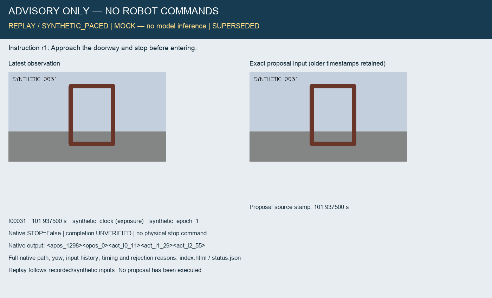

# Read-only terminal VLN advisory demo

Branch `feature/vln-shadow-demo`, isolated from completed Phase 6D publication
`1cc74909e489e1037c9f6f0051ab34e855d144dc`. This application accepts a terminal
instruction and local observations, displays proposals, and writes inspectable
evidence. **ADVISORY ONLY — NO ROBOT COMMANDS.** No live source, execution option,
Unitree client, avoidance toggle, command publisher or simulation controller is
instantiated. Even zero-velocity commands are outside this application.

## Start here

Use the existing core environment; no installation or environment changes are
needed on the current Mac. The separate model environment remains unchanged.

```bash
cd /Users/yushan/Desktop/Go2_Navigation/data/outputs/vln-shadow-worktree
export PYTHONPATH="$PWD/src"
CORE=/Users/yushan/Desktop/Go2_Navigation/data/outputs/phase6c/core-env/bin/python
ARTIFACTS=/Users/yushan/Desktop/Go2_Navigation/data/outputs/vln_shadow

"$CORE" scripts/run_vln_shadow.py \
  --synthetic --instruction 'Approach the doorway and stop before entering.' \
  --backend mock --mode paced --synthetic-frames 96 --mock-delay-s 1.2 \
  --output "$ARTIFACTS/my_synthetic_demo"
```

Open the printed `index.html` in a browser. It refreshes from local files; there
is no web server or external service. The terminal remains the input interface:

```text
instruction Turn left toward the doorway.
cancel
status
quit
```

`instruction TEXT` starts a new revision and clears inference history; the **next
actual observation** begins it. The previous camera view may remain visible but
is not restamped or fed into the new instruction. After source EOF, starting a
new revision requires restarting the source/application. `cancel` invalidates
advisory results, including a generation still running. It does **not** stop a
physical robot. `quit`/Ctrl-C cleanly close the owned worker. An ended session's
last proposal is marked historical/SUPERSEDED, not left labeled current.

The default source finishes automatically. `--stay-open` leaves the display and
terminal available after EOF, up to the declared host limit. Use a **new output
directory** each time; existing experiments are never overwritten.

### Existing private episode, mocked inference

```bash
"$CORE" scripts/run_vln_shadow.py \
  --episode /Users/yushan/Desktop/Go2_Navigation/data/outputs/phase6b/episodes/p6b_test_c_e1_turn_right/model_input/episode.json \
  --instruction 'Turn right toward the kitchen counter.' \
  --backend mock --mode fast --max-observations 24 --max-requests 2 \
  --mock-delay-s 0.1 --output "$ARTIFACTS/my_private_replay"
```

The existing episode loader validates the manifest/resources. Source pixels,
exposure/availability times, uncertainty, calibration hash and original instruction
are retained. `evaluation_only/annotations.json` is never loaded. A changed terminal
instruction is an explicitly different advisory revision; packages and old scores
are not modified. App scheduling cutoffs are recorded, but are **not** the frozen
Phase 6B benchmark cutoffs. E1–E3 remain retrospective proposal episodes; E4 remains
a static absent-target case. All are correlated examples from `test_c`.

`--mode fast` consumes historical images as quickly as the lightweight reader
allows. `--mode paced --speed 1` schedules availability against host monotonic time;
that replay clock advances during inference. Slow input decoding catches up in
bounded batches (eight observations/tick). Neither is measured live Go2 latency.

### Real LightNav smoke command — pending resource coordination

Do not launch while the operator is testing physical motion on this Mac. The
operator was asked to confirm a safe resource window; none was confirmed during
implementation. The command below is prepared, **not recorded as executed**.

```bash
MODEL=/Users/yushan/Desktop/Go2_Navigation/data/outputs/phase6c/model-env/bin/python
ASSETS=/Users/yushan/Desktop/Go2_Navigation/data/outputs/phase6c/lightnav
"$CORE" scripts/run_vln_shadow.py \
  --episode /Users/yushan/Desktop/Go2_Navigation/data/outputs/phase6b/episodes/p6b_test_c_e1_turn_right/model_input/episode.json \
  --instruction 'Turn right toward the kitchen counter.' \
  --backend lightnav --model-python "$MODEL" --assets "$ASSETS" \
  --runtime-config configs/pretrained_vln.yaml --device mps \
  --mode paced --max-observations 24 --max-requests 1 \
  --output "$ARTIFACTS/real_model_smoke_01"
```

This starts one local child, verifies cached pinned assets, loads once, then accepts
one job at a time through stdin/stdout. Playback starts **after model readiness**;
it does not pause for subsequent inference. A result outside the advisory age limit
is saved and marked STALE, even when native generation succeeded. Inspect `worker/
model.json`, each `requests/*/native/` and `receipt.json`; do not interpret a mock
run or an earlier Phase 6D inference result as verification of this new entry point.

Fixed model: `LightOriginsHQ/LightNav-0@826dc5fbfa37afa8293d2e336d329b6ffc0bfb64`;
source `3015508b70fb6e30bbd66701e94c9b916dcb8df8`. Existing same-BF16 CPU pooling
fallback patch SHA256 `bec34b7d855f33ac94ec212a61ca507d2d677d82441add0cd1b2dfe7088e554c`
is unchanged. MPS/BF16/SDPA, no quantization. Other device selections are subject
to the existing runtime validator, not an assertion of feasibility.

## Design and contracts

- `shadow_sources.py`: `EpisodeSource` reads existing model-input packages;
  `SyntheticSource` produces deterministic pinhole images, not a simulator or an
  accuracy test. `ObservationInbox` is a bounded consumer for a **future externally
  owned read-only receiver**, not a hardware driver.
- `shadow.py`: `ShadowSession` stores the existing `Go2VLNObservation` via its
  existing NPZ serializer, retains bounded history references, and creates immutable
  serialized snapshots of the existing six-field native job. Session identity is
  an outer envelope, not a replacement observation/proposal schema.
- `shadow_worker.py` and internal `scripts/vln_shadow_worker.py`: one child using
  existing `lightnav_worker.verify_assets`, `validate_jobs`, `run_job`. Official
  processor, normalization, template, SlowFast sampling and RVQ decoding are reused.
  The application parent imports no Torch/model stack. Mock delay uses an injected
  monotonic clock, with no generation or semantic inference.
- `shadow_display.py`: local HTML/status JSON and a small PNG. Latest raw image
  and actual model-input image/history carry different timestamps. Native target
  pointing is shown only on the corresponding model input; the full waypoint chunk
  and yaw are a separate local chart/table. No old path is registered to a new view.

### History and cancellation

One request is in flight; one pending dirty flag is coalesced to the newest available
snapshot. Observations continue arriving independently. Dropping scheduling notices
does not delete observation history. Every request/response carries session ID,
instruction revision, source ID, clock epoch, history generation and sequence.
Wrong identities, changed instructions/epochs, invalid history, age/deadline expiry
and cancellation reject late results. Crossing an epoch invalidates old requests
even if an old epoch name subsequently reappears.

`pretrained.causal_history` selects **actual** available observations on the existing
latest-anchored 4 Hz grid. Quantization errors are retained; sparse/missing/gapped
streams pause inference instead of padding, copying frames or compressing time.
The pinned SlowFast policy includes episode anchors, so a recent-only ring buffer
would change its semantics. Instead, keep all source observations for a bounded
instruction session and stop accepting new inference at the limit. Do not silently
evict anchors. Start a new instruction revision to begin a new bounded history.

Each request reconstructs this complete causal instruction history through the
**existing Phase 6C reset/rebuild path**. This is deliberate, not Phase 6D's
append-only exact-simulation-grid mode: irregular camera arrivals and latest-anchored
sampling can change the selected prefix. HF has no required executed-action feedback
or persistent conversational state. No previous proposal is supplied as an executed
action. Official SlowFast chooses history after reconstruction. Native buffer/cache
resets therefore also isolate revisions and epochs. Processor tubelet duplication
remains separately recorded upstream behavior, not invented source observations.

Defaults: 1,024 source observations/60 source seconds per instruction, 4,096 total
observations and 64 submitted requests per invocation, 180 host seconds including
startup. History references, queue and native snapshots are bounded. Observation
arrays are disk-backed private NPZ files, not an unbounded RAM list. At a history
limit, the latest camera continues updating but inference pauses explicitly.
Run-level limits end the invocation. `--help` lists configurable bounds.

### Timing

No robot-clock timestamp is subtracted from host wall time.

| Field | Meaning |
|---|---|
| source stamp, cutoff, uncertainty | Original source clock/domain/epoch; seconds. |
| host submit/start/end | Same-machine monotonic seconds; cannot be compared across machines. |
| inference duration | Child `run_job` interval including preprocessing and evidence serialization; native generation/engine timings remain separately saved. |
| paced display age | `(source_anchor + elapsed_host * speed) - source_stamp`; **virtual replay seconds**, not live latency. Stamp semantics distinguish exposure, estimated exposure and receipt. |
| fast display age | `null`: historical capture-to-host mapping is not available. Source age at cutoff, latest source lag and host time since delivery are shown separately. |
| future live age | Only from an explicitly supplied exposure-to-host-monotonic mapping with provenance. Otherwise unknown; time since consumer receipt is not exposure age. |

Default advisory limit: 3 s (applied independently to calculable age, source lag and
host time since delivery). Request deadline: 10 s; owned-child timeout: 30 s. These
are configurable **display settings, not physical safety limits**. They do not
reuse the simulator's 120 s timeout. Display validity is recomputed as time passes,
even without a new result. Source uncertainty is displayed, not claimed as a hard
safety bound. All rejected/superseded native evidence remains local and labeled.

### Future sensor consumer

Claude should read [GO2_VLN_INPUT_INTERFACE](GO2_VLN_INPUT_INTERFACE.md) and
[VLN_CONTROL_HANDOFF](VLN_CONTROL_HANDOFF.md). The payload remains the existing
`Go2VLNObservation`: RGB uint8; measured K/D/distortion model and intrinsics size;
`Stamp` objects for exposure/receipt with uncertainty; clock epoch; optional
`RobotState` and separate `GeometricObservation`. `None` stays unknown, never identity.
The app receives only the current visual frame (`visual.history=[]`), since it owns
sampling/history. Missing images/calibration or clock ambiguity pause inference.

```python
from go2_perception.vln.shadow_sources import ObservationInbox
inbox = ObservationInbox(capacity=2)
# In Claude's already-validated read-only receiver callback, after hardware tests:
accepted = inbox.offer(
    observation,                    # existing Go2VLNObservation; not a ROS/SDK message
    source_id="operator_assigned_recording_or_stream_id",
    frame_id=unique_frame_id,
    available_s=availability_in_the_visual_stamp_clock,
    received_monotonic_s=local_receipt_monotonic,
    provenance={"receiver_revision": verified_receiver_commit},
)
# On the application event-loop thread:
# session.receive(inbox.get_nowait(), time.monotonic())
# On overflow, report loss with session.invalidate_history(...), or begin a new
# revision. Never silently drop frames and claim uninterrupted native history.
```

The inbox copies ownership before returning. `exposure_monotonic_s` may optionally
be supplied **with** `monotonic_mapping` provenance; retain the total clock/latency
uncertainty in the source stamp. Without a verified mapping, leave both unset.
`available_s` must already be in the chosen visual stamp's clock domain. Receipt-only
timestamps are allowed, explicitly labeled; they do not acquire exposure semantics.
`live_unvalidated` is an API status label only; the CLI has no live driver option.
Sensor-to-model integration remains untested and requires a separate operator test.

## Verification and artifacts (2026-11-15)

Lightweight regression command, using no model/GPU/simulator/hardware:

```bash
PYTHONPATH=src "$CORE" -m pytest -q \
  tests/test_vln_shadow.py tests/test_pretrained_vln.py tests/test_vln_episodes.py
```

Initial run: **109 passed in 1.17 s**. Final: **114 passed in 1.56 s**, including
57 new tests and 57 existing contracts. No cases skipped in this selected set.
Logs: `data/outputs/vln_shadow/audit/lightweight_tests_final.{log,xml}`.
A short-source warm-up scheduling bug was found by the real terminal-entry-point
mock test and corrected: warm-up defers dispatch without clearing pending input.
Its failing log is retained as `audit/short_source_warmup_failure.log`.
Coverage includes observation/instruction provenance, native causal sampling,
bounded queues, stale/wrong/superseded responses, cancellation during inference,
epoch and instruction resets, missing data, malformed outputs, STOP separation,
owned-worker shutdown, and absence of control imports/options.

Actual application runs under `/Users/yushan/Desktop/Go2_Navigation/data/outputs/vln_shadow/`:

| Run | Actual verification |
|---|---|
| `synthetic_paced_v1/` | 48 observations, 3 delayed mock proposals accepted; 29 coalesced scheduling notices. No model inference. |
| `synthetic_paced_v2/` | 32 observations, 3/3 mock proposals accepted; readable local display. |
| `published_demo/` | Final code, 32 observations and 3/3 mock proposals; source/config hashes bound in `run.json`. |
| `synthetic_stale_v1/` | 32 observations; 1.2 s mock inference with a 0.5 s advisory limit; 2/2 results rejected as stale. |
| `private_e1_mock_v1/` | Existing E1 package, 24 images, 2 mock proposals accepted; measured fisheye rectification, uncertainty retained, fast replay age unknown. Package unchanged. |

Each run contains `index.html`, `advisory.png`, `status.json`, `last_active_status.json`,
`summary.json`, `events.jsonl`, source observation NPZ/metadata, immutable jobs,
snapshots and response receipts. Real-model runs additionally retain all original
native tensors/images/text and model identity/memory metadata. All private media,
scene instructions/logs and weights remain under ignored `data/outputs/` paths.
The published demo screenshot contains only generated synthetic imagery.

`audit/input_and_environment_audit.json` records core Python 3.12.11, NumPy 1.26.4,
OpenCV 4.11.0.86, Pillow 11.1.0, PyYAML 6.0.2, pytest 8.3.5 and jsonschema 4.26.0,
and verifies all 107 E1 images/calibration against the existing manifest without
loading annotations. Runtime/library metadata was read without importing the model.



**Pending:** new-entry-point real inference, full repository regression suite, and
live receiver connection. The earlier Phase 6D 591-pass/9-skip suite and 121 real
model calls are historical evidence, not rerun claims. No heavy verification was
started without operator coordination. After a safe resource window, run the one-job
smoke above, then the existing full regression command from
[PHASE6D_NAVIGATION_EXPERIMENTS](PHASE6D_NAVIGATION_EXPERIMENTS.md), using this worktree's
`PYTHONPATH`. Existing viewer tests expect an ignored `.venv` alias to `core-env`;
create that alias in this isolated worktree only if absent. Never replace an environment.

Known limits: real `T_base_camera` unresolved; native ego metres/radians are not Go2
base commands; no measured target distance, navigation-success or safety evidence.
Native STOP and APOS completion are separate from verified completion and physical
stopping. Both Phase 6D near-goal conditions failed. Optional LiDAR is independent
geometry, not a fused semantic map or certified traversability. This app does not
repair those model/registration limitations.
